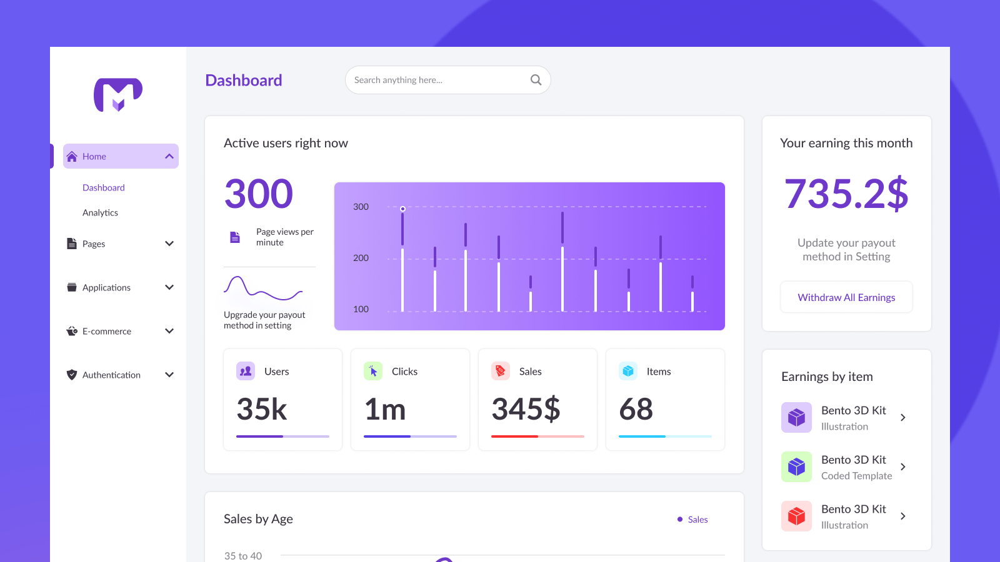

# Визуальная основа VulnPulse Desktop

Решение пользователя от 2026-11-05: использовать указанный макет Figma как основу фронтенда. Этот документ фиксирует референс для стадии Renderer и отделяет наблюдения от предлагаемых параметров реализации.

Этапы подключения, зависимости от сервисов/IPC и критерии готовности описаны в [плане интеграции фронтенда](docs/frontend-integration-plan.md).

Актуализация 2026-11-08: реализованы [оболочка Mint и каталог](docs/catalog-ui.md), [Обзор](docs/dashboard-ui.md) с KPI/Recharts/состоянием источников и [Стек ПО](docs/stack-ui.md) с таблицей/CRUD/импортом конфигурации и [Заметки / SLA](docs/workflow-ui.md) с выбором владельца/формами UTC. Токены, системный шрифт, плотная таблица и карточка адаптированы по этому референсу; снимки Electron сохранены в `docs/design/screenshots/`. Атрибуция доступна в приложении и [THIRD_PARTY_NOTICES.md](THIRD_PARTY_NOTICES.md). Ниже наблюдения исходного исследования 2026-11-05 сохранены отдельно от реализации.

## Источник и проверка

- [Free Admin Dashboard UI Kit / Mint](https://www.figma.com/community/file/1244293267600418871/free-admin-dashboard-ui-kit), Community file ID `1244293267600418871`.
- Автор: [Ali / @malik_ali](https://www.figma.com/@malik_ali). В описании набор называется Mint и содержит готовые приложения и компоненты.
- На публичной странице указана лицензия [CC BY 4.0](https://creativecommons.org/licenses/by/4.0/). Сохранить имя автора и ссылку при использовании материалов; при адаптации обозначить изменения в сведениях о заимствованном дизайне.
- Проверено 2026-11-05: публичная страница получена через Firecrawl (HTTP 200), визуально просмотрены обложка и отдельное превью Dashboard; два изображения сохранены в репозитории.
- Внутренние страницы Figma, дерево слоёв, variables, точные размеры, названия шрифтов, состояния компонентов и адаптивные варианты не извлечены. Наличие восьми превью на странице не означает, что все они изучены.

Автоматически извлечённые branding/CSS-параметры публичной страницы относятся к оболочке сайта Figma. Её синий акцент `#0D99FF`, логотип и шрифты не являются токенами Mint и не переносятся в VulnPulse.

## Сохранённые референсы

| Локальный файл | Назначение | Первичный источник |
| --- | --- | --- |
| [mint-cover.png](docs/design/reference/mint-cover.png) | Обложка набора, примеры экранов и общий характер | [Обложка Figma](https://s3-alpha.figma.com/hub/file/2371256804280792662/8367093c-41dc-44b1-bf16-dbf3a71e94ee-cover.png) |
| [mint-preview-2.png](docs/design/reference/mint-preview-2.png) | Основной изученный Dashboard, меню, карточки и графики | [Превью Figma](https://s3-figma-hubfile-images-production-cdn-cgi.figma.com/cdn-cgi/image/format=auto,quality=85/hub/file/carousel/img/506d35995252f6dfb50813991819e803aae5df0f/ca94cf69461c9db87b89c5c1d34fbb33e613e338) |

Превью — материалы для сверки. Рабочие экраны строятся компонентами React, графики — Recharts, иконки — lucide-react.

## Наблюдаемая визуальная система

- Светлая тема: белая левая навигация и карточки на очень светлом серо-сиреневом фоне.
- В левой панели — логотип сверху, пункты с иконками и раскрываемые группы. Активная группа выделена светлой сиреневой плашкой и фиолетовым текстом.
- В верхней части рабочей области — название раздела и округлённый поиск.
- Dashboard использует широкую основную колонку и более узкую правую колонку. В большой карточке совмещены крупная метрика, график и ряд небольших KPI-карточек; ниже продолжается сетка графиков.
- Карточки с небольшим скруглением, тонкой границей и слабой тенью; внутри преобладают простые выравнивания и свободные интервалы.
- В графиках преобладают фиолетовые/сиреневые линии, столбцы и заливки; сетка и подписи приглушены. Есть вторичные цветные иконки и маленькие индикаторы.
- Обложка показывает дополнительные экраны с тем же боковым меню, карточками и графиками. Большой фиолетовый фон обложки — презентационное окружение; рабочая область Dashboard светлая.

## Цвета

Значения ниже измерены по пикселям сохранённого Dashboard, а не извлечены из переменных Figma. Они служат стартовыми значениями для реализации; сглаживание и преобразование превью могут отличаться от исходных заливок.

| Семантическая роль | Значение по превью | Использование |
| --- | --- | --- |
| Фон рабочей области | `#F4F5F9` | Основная поверхность приложения |
| Поверхность | `#FFFFFF` | Sidebar, карточки, таблицы, панели |
| Основной акцент | `#6E39CB` | Выделение, активные элементы, основные серии графиков |
| Мягкий акцент | `#DECCFE` | Фон активного пункта и вторичные заливки |
| Основной текст | `#3A3541` | Заголовки, значения, подписи строк |

Для Tailwind/shadcn использовать семантические CSS-переменные `background`, `card`, `primary`, `primary-foreground`, `accent`, `foreground`, `muted-foreground`, `border`, `ring`. Вторичный текст и границы подобрать при реализации и проверить контраст. Статусы и severity не кодировать одним фиолетовым: Critical/High/Medium/Low и KEV получают отдельные смысловые индикаторы с текстовыми подписями. Их палитра ещё не утверждена как часть исходного макета.

## Типографика и размеры: предложения для VulnPulse

Точные семейства и размеры исходного файла не подтверждены. Следующие значения — предлагаемые параметры адаптации для плотного desktop-интерфейса:

| Параметр | Предложение |
| --- | --- |
| Шрифт | Inter с кириллицей, если подключается локально; fallback `Segoe UI, sans-serif` |
| Основной текст / таблица | 13–14 px; не уменьшать текст ниже читаемого уровня ради плотности |
| Заголовок экрана | 22–24 px, semibold |
| Заголовок карточки | 15–16 px, medium/semibold |
| Значение KPI | 28–36 px; уменьшено относительно маркетингового Dashboard |
| Шкала отступов | 4 / 8 / 12 / 16 / 24 px |
| Ширина Sidebar | Ориентир 216–232 px; проверить на реальном окне Electron |
| Отступ рабочей области | 20–24 px, промежуток карточек 16–24 px |
| Скругление карточек | Ориентир 8 px; единое для панелей и таблиц |
| Строка dense-таблицы | Ориентир 36–40 px; удобные зоны нажатия и видимый focus |

Светлая тема — подтверждённая основа референса. Тёмная тема, минимальная ширина окна, сворачивание Sidebar, mobile-layout и hover/анимации в этой работе не исследовались.

## Применение к продукту

| Раздел VulnPulse | Как использовать основу |
| --- | --- |
| Уязвимости | Общая оболочка Mint; поиск и компактные фильтры сверху, основная площадь — плотная таблица. Severity, статус, KEV и актуальность источника читаются без открытия строки |
| Dashboard | Сетка белых карточек, KPI и графики в стиле Mint; метрики уязвимостей, KEV, SLA и свежести фидов вместо выручки и продаж |
| Стек | Та же оболочка и таблица компонентов; форма добавления CPE/PURL и версии |
| Заметки / SLA | Согласованные карточки и формы с фокусом на рабочей проблеме и сроке |
| Настройки | Секции источников, синхронизации и приватности; ключи не показываются в списочных данных |

Таблица уязвимостей, формы, карточка детали и эти продуктовые сопоставления — адаптация к VulnPulse, а не подтверждённые экраны исходного набора. Финансовые блоки, ecommerce-навигация, аватары и логотип Mint не становятся содержимым VulnPulse автоматически.

## Правила реализации

- Сохранить утверждённые React + TypeScript, TailwindCSS, shadcn/ui, lucide-react, Recharts и Zustand. Компоненты размещать в `src/renderer/src/components/` и `views/`.
- Данные — только через типизированный `window.electronAPI.*`; SQLite, матчинг и вычисление агрегатов остаются в Main. Zustand хранит состояние интерфейса.
- Поддержать клавиатуру, быстрые фильтры, видимый focus, загрузку, пустые состояния, ошибки и отмену синхронизации. Цвет дополняет текст, а не заменяет его.
- Референс задаёт визуальную основу. Плотность таблиц и смысловые цвета адаптируются под AppSec/SOC; стиль сохраняется между экранами.
- На стадии реализации сверить размеры и компоненты с доступными страницами Figma; не выдавать оценки по превью за точную реконструкцию.
- Первоначальная запись фиксировала дизайн до реализации. На 2026-11-08 ядро/IPC, каталог, Обзор, Стек ПО и Заметки / SLA реализованы; следующий пункт — Settings. Подробные границы — в отчётах четырёх экранов.

Проверки этой записи: чтение публичной страницы, визуальный просмотр двух сохранённых PNG, выборка цветов Dashboard. Код приложения не менялся; typecheck/tests/build для документирования референса повторно не запускались.
