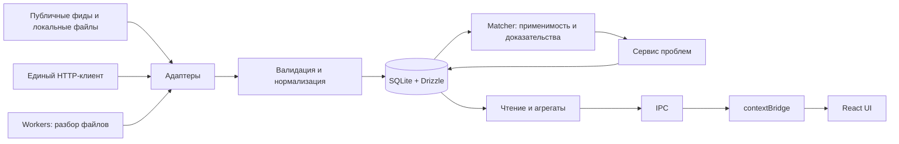

# VulnPulse Desktop

**Локальный центр управления уязвимостями для AppSec, SOC и руководителей ИБ.**

VulnPulse Desktop будет собирать сведения из NVD, OSV, CISA KEV и БДУ ФСТЭК, сопоставлять их с программным стеком организации и помогать вести работу от обнаружения до подтверждения исправления. Пользователь сможет понять, какие проблемы относятся к его компонентам, почему получено совпадение, что исправлять в первую очередь и какие сроки уже нарушены.

Основная версия — настольное приложение с локальной базой, без обязательного аккаунта и облачного сервера. Работа с сохранёнными данными должна быть доступна без интернета. Отправка сведений о пакетах во внешние API допускается только в отдельно включённом пользователем режиме.

**Состояние на 8 ноября 2026 года:** версия `0.1.0`, реализованы ядро, планировщик, каталог, обзор с агрегатами Main, экраны Стек ПО и Заметки / SLA; готового пользовательского MVP пока нет. Разделы про MVP и полную версию описывают проект развития, а не доступные функции. Анализ выполнен по исходникам, тестам и документации поставщиков. Дальнейшие предложения по схеме и поведению не заменяют правила AGENTS.md; реализованные части перечислены в текущем статусе.

## Для кого и какую задачу решает проект

| Пользователь | Основная задача |
| --- | --- |
| AppSec-инженер | Сопоставить зависимости с уязвимостями, проверить применимость и организовать исправление |
| SOC / аналитик ИБ | Найти известные эксплуатируемые уязвимости в своём стеке и проверить основания для приоритета |
| Владелец системы | Получить список затронутых компонентов, рекомендации источников и сроки устранения |
| Руководитель ИБ | Видеть актуальность данных, подтверждённые проблемы, просрочки и динамику исправлений |

Будущий сценарий: добавить компонент с версией и CPE/PURL → обновить базы → получить объяснимое совпадение → проверить применимость → перевести проблему в работу → после обновления компонента зафиксировать исправление с датой и заметкой.

Активное сканирование сети, эксплуатация уязвимостей, автоматическая установка патчей и доказательство достижимости уязвимого кода не входят в MVP. Совпадение по версии само по себе не доказывает возможность эксплуатации в конкретной среде.

## Что уже реализовано

| Область | Фактическое состояние |
| --- | --- |
| Electron | Окно, Main / Preload / Renderer, `contextIsolation: true`, `nodeIntegration: false` |
| База | `node:sqlite` + Drizzle, внешние ключи, WAL для файловой БД; добавлены записи и связи источников |
| Миграции | SQL из `schema.ts`, собственный транзакционный раннер, `schema_migrations` |
| Общие типы | Enum, прежние insert-типы и независимые публичные read/command DTO каталога и стека |
| Matcher | CPE/PURL, равенство для прежних путей; NVD: положительные OR, числовые диапазоны, match/no_match/unknown и доказательства |
| HTTP-клиент | Axios, общий лимит параллельных запросов, backoff/jitter, Retry-After, тайм-ауты, отмена и ограничения размеров |
| Тесты | 892 unit-теста в 31 файле; 21 Electron E2E, включая каталог/обзор/стек/заметки-SLA UI, sync/import API и Windows safeStorage |
| Интерфейс | Оболочка Mint, каталог с фильтрами/страницами/деталями и сменой общего статуса, локальный импорт и меню Данные. Preload: каталог, stack, notes/SLA, Settings/ключ NVD и sync/import. Обзор: KPI/график Recharts, общие статусы, состояние источников и переходы к фильтрам. Стек ПО: просмотр импортированной конфигурации, CRUD и формы CPE/PURL. Заметки / SLA: выбор владельца, CRUD заметок, точные даты UTC, состояния Main и переходы в карточку. Следующий экран — Настройки |
| Фиды и фон | Четыре адаптера в поддержанных режимах; сохранённые интервалы/opt-in автозагрузки, NVD читает ключ в Main, отмена через меню. В новой БД авто выключено; OSV локальный. Sync/import IPC реализован с общими операциями меню/API/cron; автопересчёт matcher впереди |

Покрытие текущего matcher не означает полную реализацию стандартов CPE/PURL и правил версий всех экосистем. Для NVD реализованы положительные OR и ограниченная числовая политика диапазонов; AND, отрицание и неподдержанные версии дают unknown. В OSV поддержаны явные версии npm/PyPI/Maven и npm SEMVER-диапазоны. Другие порядки версий, GIT/ECOSYSTEM и limit пока дают unknown.

Рабочий каталог: [описание и ограничения](docs/catalog-ui.md), [снимок Electron на синтетических данных](docs/design/screenshots/catalog-1280.png). Статус в нём относится ко всей уязвимости; применимость к компонентам и автоматический matcher ещё не подключены. [Обзор](docs/dashboard-ui.md) показывает агрегаты сохранённого каталога; полнота фидов не оценена.

## Границы MVP

Один пользователь, одно локальное рабочее пространство, один запущенный экземпляр Electron с его штатными процессами, каталог компонентов и полный ручной цикл работы с проблемой.

| Возможность | Содержание MVP |
| --- | --- |
| Инвентаризация | Добавление и изменение компонентов: тип, имя, версия, CPE/PURL; проверка согласованности версии и идентификатора |
| Источники | CISA KEV и NVD по сети; OSV в разрешённом режиме; БДУ ФСТЭК через ручной XML-импорт |
| Применимость | CPE и пакеты npm/PyPI/Maven в явно заявленных пределах поддержки; точные версии и проверенные диапазоны; отдельное отображение неопределённости |
| Рабочая таблица | Поиск, фильтры по источнику, критичности, KEV, компоненту и статусу, сортировка, постраничная загрузка, горячие клавиши |
| Карточка проблемы | Уязвимость, компонент, источники, объяснение совпадения, заметки, срок, история статусов |
| Приоритет | KEV, критичность, подтверждённая применимость и просрочка как отдельные понятные признаки |
| Синхронизация | Свежесть и охват фидов, ошибки, прогресс, отмена, ручной запуск, расписание при работающем приложении |
| Обзор | Проблемы, просрочки, критичность, KEV и свежесть источников с точными определениями показателей |
| Сохранность | Миграции с сохранением данных, резервная копия и восстановление БД |
| Поставка | Установщик и полный сценарий на первой поддерживаемой платформе; первым кандидатом является Windows |

macOS и Linux — целевые платформы архитектуры. Готовность каждой подтверждается отдельной сборкой и тестами. Планировщик не работает после полного выхода; догоняющая проверка выполняется при старте для сохранённых включённых источников и при включении источника.

### Критерии готовности MVP

1. Пользователь проходит путь от ввода компонента и загрузки фида до анализа, SLA и фиксации исправления; результат сохраняется после перезапуска.
2. Повторный импорт не создаёт дубликатов. Одна CVE из CISA и NVD сохраняет оба происхождения и пользовательские заметки.
3. Неизвестные версии, повреждённые записи и неподдерживаемые условия не превращаются в заключение «безопасно».
4. Сбой сети, отмена и перезапуск не теряют рабочую базу и не продвигают курсор за необработанные данные.
5. Исправление у одного компонента не закрывает проблему у другого. Повторный матчинг сохраняет действия аналитика.
6. Проверены сетевое поведение, недоверенное содержимое, восстановление копии и запуск установленного приложения.
7. Измерена скорость на согласованном наборе данных. Предварительная цель: 1 000 компонентов, 100 000 записей источников, страница из 100 строк до 500 мс по p95 на машине с 4 ядрами, 8 ГБ RAM и SSD. Это проектный бюджет, текущих измерений нет.

## Оценка технологического стека

**Рекомендация: сохранить Electron, TypeScript, React, SQLite и Drizzle.** Они соответствуют локальному приложению с насыщенными таблицами и интеграцией с файловой системой. Главные ограничения находятся в предметной модели и обработке данных, а не требуют смены платформы.

| Решение | Оценка и условия применения |
| --- | --- |
| Electron + TypeScript | Единая кодовая база и типизированный IPC. Цена — размер поставки, память и регулярное обновление Electron/Chromium |
| React + TailwindCSS | Достаточная основа UI; shadcn/ui и lucide-react добавлять на стадии интерфейса, сохраняя доступность |
| Zustand | Фильтры, выделение и состояние UI; БД остаётся источником истины, бизнес-правила находятся в Main |
| Recharts | Агрегированные графики; расчёты выполняет сервис, Renderer получает небольшие наборы |
| SQLite / `node:sqlite` | Транзакционное локальное хранилище без сервера. Синхронные операции требуют ограниченных пакетов и контроля задержек |
| Drizzle + drizzle-kit | Типизированные запросы и схема. RC-зависимости требуют воспроизводимой установки и проверки миграций под Electron |
| Собственный раннер | Подходит для SQL внутри Main-бандла; нужны строгий порядок, неизменность применённых миграций и тесты обновления |
| Axios + единый HTTP-клиент | Общее управление лимитами, повторами, тайм-аутами и отменой; дополнительная сетевая платформа не нужна |
| `fast-xml-parser` / Cheerio | XML — основной импорт ФСТЭК; Cheerio добавлять при подтверждённой необходимости HTML-резерва |
| node-cron | Источник сигнала запуска; состояние заданий, блокировки и восстановление обеспечивает приложение |
| Vitest / Playwright | Unit-тесты дополнить интеграционными, миграционными и E2E именно Electron-приложения |
| electron-vite / electron-builder | Первый уже собирает приложение; второй планируется для установщиков, подписания и обновлений |

Drizzle документирует подключение готового `DatabaseSync` и синхронные методы query builder. Сохраняется проектное правило использовать `select`/`insert`/`update`, не опираться на RQB `db.query.*`. Совместимость проверяется на закреплённой паре версий, а не переносится автоматически на все релизы. [Drizzle: Node SQLite](https://orm.drizzle.team/docs/sqlite/connect-node-sqlite).

`DatabaseSync` выполняет операции синхронно: обёртка в `async` не делает тяжёлый запрос неблокирующим. В MVP допустимы короткие операции в Main; крупные импорты дробятся, парсинг выполняется в worker. [Node.js 24: SQLite](https://nodejs.org/download/release/v24.0.0/docs/api/sqlite.html).

## Целевая архитектура MVP

Модульный монолит: одна поставка, чёткие границы внутри Main и узкий API для UI. Для MVP не нужны отдельный веб-сервер, Redis, брокер сообщений или микросервисы.



Схема показывает обработку данных. Команды пользователя идут отдельно: `Renderer → preload → IPC → сервис → БД`; ответы и события возвращаются обратно. Это не циклические зависимости модулей: сервисы не импортируют Renderer, а результаты matcher записываются как следующий шаг конвейера.

### Границы модулей

- **Main:** окно, жизненный цикл, БД, регистрация сервисов/IPC, завершение заданий и закрытие БД.
- **HTTP-клиент:** лимиты по источнику/ключу, ограниченные повторы с exponential backoff и jitter, `Retry-After`, отмена, тайм-ауты, размеры ответов, безопасные редиректы и очистка секретов в логах.
- **FeedAdapter:** `fetchIncremental` получает страницы или локальные данные, `parse` проверяет/нормализует, `upsert` делегирует транзакционную запись сервису импорта. Адаптер не меняет статусы аналитика.
- **Синхронизация:** один запуск на источник, курсоры и коммит пакетов, прогресс. Ручной запуск и node-cron используют один путь.
- **БД / репозитории:** параметризованные запросы, транзакции, ограничения, стабильная пагинация, индексы и агрегаты.
- **Matcher:** чистые функции без SQL и сети. Кандидатов по индексам продукта/пакета выбирает сервис.
- **Сервис проблем:** объединяет автоматические сведения со статусом, заметками и SLA, сохраняя ручную работу при пересчёте.
- **IPC / preload:** конкретные методы, runtime-валидация, проверка отправителя и ограниченные ответы. Сейчас реализованы `vulnerabilities.list/get/setStatus` с глобальным статусом; API findings и события остаются предложениями.
- **Renderer:** отображение, ввод и фильтры; hooks для IPC. Применимость и приоритеты вычисляются в сервисах.

## Модель данных для рабочего MVP

В схему добавлены записи источников и связи с уязвимостями; миграция переносит существующие данные. Локальные импорты OSV/ФСТЭК и каталог UI реализованы; независимая работа по компонентам потребует дальнейшей работы над моделью.

| Сущность | Назначение и связи |
| --- | --- |
| `feeds` | Настройки и состояние источника; отключение без удаления пользовательских данных |
| `sync_runs` / состояние синхронизации | Запуск, результат, счётчики, ошибка, курсор, последний полный успех и охват |
| `source_records` | Уникальность `(feed_id, source_id)`, исходный payload, версия парсера, хеш, даты и отзыв |
| `vulnerabilities` | Стабильный внутренний ID канонической уязвимости и представление для чтения |
| `vulnerability_identifiers` | CVE/GHSA/BDU и другие идентификаторы с типом и подтверждёнными связями |
| `vulnerability_sources` | Связь источников и уязвимостей; учитывает запись, относящуюся к нескольким CVE |
| `affected_rules` | Пакет/CPE, границы версий, дерево условий и ссылка на исходную запись |
| `stack` | Конкретная учётная запись компонента; разные установки нельзя сливать только по названию |
| `matches` / `findings` | Автоматический результат и рабочая проблема по паре «уязвимость + компонент», объяснение, статус, первое/последнее обнаружение |
| `notes`, `sla`, `status_history` | Работа по проблеме; общая заметка к уязвимости при необходимости хранится отдельно |
| `settings` | Версионируемые настройки; секреты отдельно защищены средствами ОС |

Принципы хранения:

1. **Источники не перезаписывают друг друга.** Сохраняются происхождение и значения; отсутствие поля у одного источника не очищает другое. Отключение фида не удаляет заметки/SLA каскадом.
2. **Объединение требует доказательств.** Явные идентификаторы и подтверждённые alias-связи; похожие заголовки, `related` и ссылки на другую CVE недостаточны. Неоднозначные записи сохраняются раздельно до разрешения связи.
3. **Статус относится к компоненту.** Одна CVE может быть `Patched` в одном месте и `Affected` в другом. Общий статус в списке уязвимостей — вычисляемая сводка.
4. **Исходные данные остаются внутри Main.** `rawJson` хранится у записи источника, не включается в списочные IPC DTO. Для XML сохраняются метаданные импорта и при необходимости ограниченная исходная копия. Нужны срок хранения и лимиты объёма.
5. **Каталог отдельно от workflow.** Отзыв записи, исчезновение условия и устаревание фида не означают `Patched` или `False Positive`.
6. **Чтение отличается от создания.** IPC получает отдельные DTO с обязательными ID и явными `null`. Нынешний `InferInsertModel` не должен автоматически стать контрактом чтения. Типовую зависимость `shared → main/db/schema` следует убрать при выделении контрактов; runtime-доступа к БД она сейчас не создаёт.

Статусы сохраняются: `New`, `Analyzing`, `Affected`, `In Progress`, `Patched`, `False Positive`. Переходы проверяет сервис; закрытие фиксирует основание, дату и версию компонента. Повторное обнаружение требует видимого пересмотра с сохранением истории.

CVSS хранится с версией, вектором и источником. Неизвестная критичность отличается от `None`. KEV — отдельный признак, а срок CISA — отдельное поле источника, не автоматически назначенный внутренний SLA.

Переход выполняется новыми миграциями с сохранением ID, записей и пользовательской истории. Перенос глобального статуса/SLA в проблемы компонентов требует явного правила, особенно если у одной уязвимости несколько совпадений. Перед миграцией — согласованная резервная копия и тест на заполненной БД; существующую пользовательскую базу нельзя считать пустой или удалять ради новой схемы.

## Источники и надёжная синхронизация

| Источник | Роль | План обработки |
| --- | --- | --- |
| CISA KEV | Известная эксплуатация и действия из каталога | Официальный JSON, ETag при поддержке сервером, 304 и полные снимки |
| NVD | CVE, оценки, конфигурации CPE | Пагинация, лимиты, начальная загрузка и инкременты по `lastModified`, исходные условия |
| OSV | Уязвимости пакетов | Онлайн: `/v1/querybatch` и подробности; локально: импорт/зеркало публичных наборов и собственный matcher |
| БДУ ФСТЭК | Сведения БДУ и внешние идентификаторы | XML-импорт с проверкой формата, worker и протоколом ошибок; авто-загрузка вторична |

KEV не даёт готовых CPE-диапазонов: его схема содержит CVE, продукт, описание и действия. Связывать KEV нужно с CVE других источников, не выводить точное совпадение из названия продукта. [Официальная схема CISA KEV](https://raw.githubusercontent.com/cisagov/kev-data/main/known_exploited_vulnerabilities_schema.json).

Возможный будущий онлайн-режим потребует querybatch с сокращёнными сведениями (`id`, `modified`), пагинации и получения подробностей через `/v1/vulns/{id}`. В текущем локальном адаптере этих сетевых вызовов нет. [OSV querybatch](https://google.github.io/osv.dev/post-v1-querybatch/), [OSV details](https://google.github.io/osv.dev/get-v1-vulns/).

При продолжении 2026-11-06 прочитаны официальные страницы NVD: 5 запросов за скользящие 30 секунд без ключа, 50 с ключом; максимальное окно дат — 120 дней. Адаптер использует эти лимиты и разбивает длинные интервалы на окна. Автоматическое расписание реализовано с сохранёнными opt-in настройками; default NVD-интервал — два часа, допустимый минимум — 120 минут. [NVD: начало работы](https://nvd.nist.gov/developers/start-here), [CVE API](https://nvd.nist.gov/developers/vulnerabilities).

Общий алгоритм:

1. Зафиксировать запуск и границы окна, получить блокировку источника. Не держать SQL-транзакцию во время сети.
2. Загрузить ограниченный пакет, проверить структуру/размер и нормализовать. Повреждённые записи учитываются в отчёте.
3. В короткой транзакции сохранить записи, связи и checkpoint пакета. ETag применённого снимка обновить только после успешного применения снимка.
4. Пересчитать затронутые проблемы. Сохранить revision данных и состояние пересчёта, чтобы UI отличал актуальные результаты от ожидающих matcher.
5. Курсор полного успеха продвигать после обработки всего окна. Перекрывающиеся окна и идемпотентные upsert защищают от повторов и поздних обновлений.

При неполной загрузке нельзя считать исчезнувшие записи отозванными. UI показывает фактический охват: частичная загрузка или ограниченный период не равны отсутствию уязвимостей вне набора. Загрузки только недавних публикаций недостаточно для старых версий ПО.

## Матчинг и достоверность

Для NVD и OSV реализован результат: **совпадает**, **не совпадает в рамках проверенного условия**, **не удалось определить**. Прежние пути CPE/PURL пока возвращают только совпадения и предупреждения. Он отделён от ручного статуса. Отсутствие версии, неизвестный формат или неполные данные сопровождаются причиной неопределённости.

- **CPE:** различать ANY / NA / литерал, учитывать экранирование и направленность. Новый NVD-путь учитывает границы диапазонов; плоский список не может обойти логические условия. Экранирование и частичные wildcard пока дают unknown. Неподдержанное условие даёт неопределённость. Нельзя удовлетворять `AND` компонентами с разных машин без контекста установки. [Спецификации CPE](https://csrc.nist.gov/projects/security-content-automation-protocol/specifications/cpe).
- **PURL:** разделять идентичность, версию и значимые qualifiers. Противоречие между отдельной версией и CPE/PURL отклонять или явно исправлять.
- **Версии:** SemVer подходит для SemVer; PyPI и Maven имеют собственные правила. Общий нормализатор не является универсальным компаратором. Нужны отдельные стратегии с тестами; неподдержанные варианты остаются неопределёнными. [Python versions](https://packaging.python.org/en/latest/specifications/version-specifiers/), [Maven ordering](https://maven.apache.org/pom.html#Version_Order_Specification).
- **OSV:** сохранять явные версии, тип диапазона, включительность границ и отзыв записи. `GIT` без репозитория/коммита не оценивать как обычную строку версии. [OSV schema](https://ossf.github.io/osv-schema/).
- **Объяснение:** источник, условие, версия компонента, результат, дата и версия matcher. Текущие confidence `1.0` / `0.8` — эвристические веса, не вероятности.
- **Производительность:** сначала кандидаты по продукту/пакету, затем правила; пересчёт только затронутых компонентов, без постоянного полного перебора каталога.

Поддержка npm/PyPI/Maven объявляется после проверки правил версий: распознавания PURL недостаточно. Неподдержанные условия видны аналитику и учитываются в метриках качества данных.

## Локальность и безопасность

Локальная БД не делает любой сетевой сценарий приватным. Запрос OSV с именем/версией/PURL раскрывает эти поля оператору API; фильтры NVD по стеку также могут раскрывать интерес к компонентам. Это вывод из состава запросов.

| Предлагаемый режим | Сетевое поведение |
| --- | --- |
| Полностью автономный | Сеть отключена; локальный каталог и ручной импорт |
| Локальный анализ с обновлением публичных баз — рекомендуемый по умолчанию | Общие наборы без отправки стека; сервисы всё равно видят IP и выбранные наборы/экосистемы |
| Онлайн-проверка пакетов | Явное разрешение отправлять идентификаторы/версии в OSV; внутренние имена систем, заметки и сведения об активах не включаются |

Пользователь выбрал локальный импорт OSV JSON 2026-11-06; он реализован в Main. Это выбор режима OSV: отдельного глобального переключателя сети приложения пока нет. Автоматическое зеркало, ZIP/JSONL и querybatch не реализованы. OSV также предоставляет общие выгрузки для дальнейшего развития. [OSV: downloadable database](https://google.github.io/osv.dev/faq/).

Для первого IPC включён sandbox, заданы CSP, ограничения навигации/новых окон/webview и запрет разрешений браузера. Непроверенный `shell.openExternal()` удалён. Обработчики проверяют конкретные окно, главный frame, origin и точный URL документа. Production Renderer не обращается к сети; dev имеет отдельную политику для Vite. Безопасное отображение внешнего текста в будущих UI-компонентах остаётся отдельной задачей. [Electron security](https://www.electronjs.org/docs/latest/tutorial/security), [контракт и проверки](docs/vulnerability-api.md).

Требования проекта: содержимое фидов не исполняется; импорт имеет лимиты размера, глубины и времени; worker разгружает поток, но не является защитной песочницей. API-ключ хранится с защитой ОС и не попадает в логи/DTO. Обычная SQLite не шифрует БД автоматически; требование шифрования всей базы согласуется отдельно.

## Полная версия и масштабирование

Полная настольная версия развивает то же ядро:

- **Организация:** несколько рабочих пространств, активы/сервисы, окружения, владельцы и критичность, отдельные установки одинакового пакета.
- **Инвентарь:** SBOM CycloneDX/SPDX, затем коннекторы; происхождение и дата наблюдения, контроль исчезнувших и устаревших компонентов.
- **Точность:** расширенные компараторы, условия окружения, проверенные CPE/PURL-реализации, при необходимости VEX и исключения с основанием/сроком.
- **Приоритет:** KEV, CVSS, при необходимости EPSS, доступность актива и бизнес-критичность. Пользователь видит источник, время и формулу оценки.
- **Процесс:** владельцы, журнал изменений, политики SLA, повторное открытие, пакетные действия, отчёты и экспорт.
- **Надёжность:** возобновляемые задания, диагностика, копии и проверка восстановления, контроль версии схемы, подписанные обновления, политика хранения.
- **Поставка:** CI на целевых ОС, установщики, тест обновления предыдущей версии, лицензии зависимостей и данных.

Для больших каталогов предлагается выделить владельца SQLite в worker или utility process под управлением Main. Обмен — асинхронными командами; один владелец записывает БД, вычислительные workers обрабатывают ограниченные снимки. Объект `DatabaseSync` между потоками не передаётся. Это будущее изменение размещения сервисов, требующее отдельной проверки Electron/сборки; в MVP БД остаётся в Main.

Интерфейсы сервисов позволят вынести реализацию без переписывания UI. Сначала нужны измерения памяти, задержек БД/IPC и пересчёта; преждевременное дробление на сетевые сервисы не требуется.

### Возможное расширение для совместной работы

Командная серверная редакция — отдельное расширение: локально развёртываемый backend, серверная БД (кандидат — PostgreSQL), аутентификация/SSO, роли, аудит и централизованная синхронизация. Desktop сможет стать клиентом с кэшем; понадобятся разрешение конфликтов и политика размещения данных.

Общая сетевая папка с файлом SQLite не заменяет такую архитектуру. Обещание «данные только на этом компьютере» не переносится на серверный режим. Backend, PostgreSQL и облачная синхронизация сейчас не приняты в обязательный стек.

## Технические пробелы и порядок устранения

| Когда | Наблюдение по коду | Предлагаемое действие |
| --- | --- | --- |
| До CISA/NVD | Один `feedId`, уникальный `extId`, удаление фида каскадно удаляет зависимые данные | Записи источников и связи; пользовательский контекст независимо от фидов |
| До полноценного matcher | В NVD есть OR и числовые диапазоны; пакетных диапазонов и контекста AND ещё нет | Экосистемные стратегии и условия конкретной установки |
| До OSV | Обещание не передавать стек противоречит querybatch по PURL | Явные режимы приватности |
| При расширении IPC | Каталог получил независимые read/command DTO; прежние insert-типы ещё используются существующим кодом | Сохранять отдельные контракты для новых API |
| До Notes/SLA | Статус и SLA привязаны к уязвимости целиком | Рабочая проблема на компоненте, история, повторное обнаружение |
| До показа фидов | Защита Electron/IPC и первый UI каталога добавлены; HTML-подобный текст проверен E2E | Безопасное отображение внешнего текста и проверка компонентов UI |
| До выпуска | Есть восемь Electron E2E; backup и проверка установленного обновления впереди | Полный пользовательский цикл, восстановление, миграции |
| Перед ростом | Полный перебор matcher, синхронная БД в Main | Индексы кандидатов, пакеты, измерения, затем DB worker при необходимости |

Дополнительно: уникальность `(vendor, product, version)` не задаёт идентичность установки и содержит nullable-поля; поддержанные import/CRUD-сервисы проверяют NULL-safe дубли. CRUD явно обновляет `updatedAt` и использует его как ревизию; общий SQL-trigger для произвольных записей в обход сервиса не добавлен. У миграций нет контрольных сумм. Coverage настроен на `services/**`, обязательный порог 100% не задан; unit-тесты вне текущих tsconfig для typecheck.

В прежних CPE/PURL-путях отдельное поле `StackItemForMatch.version` ещё не используется. Новые NVD/OSV-пути проверяют согласованность версии с CPE/PURL; противоречие даёт unknown, отдельная версия уточняет отсутствующую версию PURL либо ANY в инвентарном CPE; CPE-парсер разрешает ограниченный набор экранирования; qualifiers PURL не участвуют в текущем ключе идентичности. Нужны согласование входных полей и нормативные тестовые наборы перед расширением заявленной поддержки.

## План реализации

Для выбранного Mint UI подготовлен [план интеграции фронтенда](docs/frontend-integration-plan.md): зависимости от ядра и IPC, токены/компоненты, порядок экранов и критерии проверки. Визуальная основа и превью — в [DESIGN.md](DESIGN.md).

Сохраняется порядок стадий; уточнения модели встраиваются в соответствующие пункты. Переход: реализация → typecheck/tests/coverage/build → отчёт → подтверждение пользователя.

1. **HTTP-клиент — выполнено:** тайм-ауты, отмена, лимиты и повторы; детерминированные тесты и локальный HTTP-сервер без обращения к фидам.
2. **Контракт адаптера и хранение источников — реализовано:** `fetchIncremental` / `parse` / `upsert`, отдельные `source_records`, связи с CVE, миграция и raw JSON внутри Main.
3. **CISA KEV — реализован и подключён:** каталог и обогащение по CVE; повторный импорт, условный HTTP-запрос, ручной запуск и расписание. Отдельный контролируемый live-smoke впереди.
4. **NVD — ядро реализовано и подключено в заявленных пределах:** начальный каталог, инкременты, checkpoint, CVSS, чтение страницами, положительные OR и числовые CPE-диапазоны с unknown для неподдержанных условий; ручной запуск и расписание. Живой API/ключ и сложные конфигурации ещё не проверены/не поддержаны соответственно.
5. **OSV — локальный режим реализован по выбору пользователя:** JSON-импорт через меню Данные, сохранение источников/явных CVE aliases, чтение для matcher, явные версии npm/PyPI/Maven и npm SEMVER-диапазоны. Полная семантика PyPI/Maven и другие типы диапазонов впереди; querybatch и автоматические выгрузки не включены.
6. **ФСТЭК — базовый импорт реализован:** ручной XML/XML.GZ и загрузка зеркала через общий HTTP-клиент; worker, дисковый staging, транзакция, ETag и предупреждения. Доступен через меню Данные. [Поддерживаемый формат и проверки](docs/fstec-import.md).
7. **Планировщик — реализован в текущих пределах:** общий путь ручных/периодических заданий, блокировки, состояние, отмена и догоняющий запуск. [Расписания](docs/scheduler.md) сохраняются через Settings; автоматический matcher впереди.
8. **IPC / preload — пять запланированных пунктов реализованы:** [каталог](docs/vulnerability-api.md), [стек](docs/stack-api.md), [заметки/SLA](docs/workflow-api.md), [Settings/ключ NVD](docs/settings-api.md), [sync/import](docs/sync-api.md). Есть валидация, ревизии, атомарность и общие операции меню/API/cron; workflow глобальный. Ключ OS-encrypted, в Renderer только metadata. События и числовой прогресс ещё не добавлены.
9. **UI — первые четыре пункта реализованы:** [оболочка Mint и таблица уязвимостей](docs/catalog-ui.md) с поиском, фильтрами, пагинацией, карточкой и сменой общего статуса. Добавлен [Обзор](docs/dashboard-ui.md): агрегаты Main, график Recharts, состояние источников и переходы в каталог. Добавлен [Стек ПО](docs/stack-ui.md): CRUD, поиск/страницы, импорт конфигурации и защита черновиков при конфликтах. Автоматический matcher и связи с уязвимостями ещё не подключены. Добавлен [интерфейс заметок/SLA](docs/workflow-ui.md): workflow всей уязвимости, UTC-формы, конфликты и переходы в карточку. Далее Settings.
10. **Поставка MVP:** копии/восстановление, E2E, установщик, проверка миграций, производительности и сети.

Дальнейшие модели, сетевые режимы и перенос БД — рекомендации анализа. Для OSV пользователь уже выбрал локальный импорт JSON. Уже реализованные части перечислены в текущем статусе; последующие изменения согласуются на соответствующем пункте.

### Использование HTTP-клиента в Main

`src/main/services/httpclient.ts` предоставляет `HttpClient.request<T>()` и безопасную ошибку `HttpClientError` с кодом, числом попыток и HTTP-статусом. Один экземпляр создаётся на источник/область API-ключа и используется всеми его запросами: создание клиента для каждого вызова сбрасывает лимит. Заголовки и параметры передаются явно; автоматического определения ключа NVD нет.

```typescript
import { HttpClient, NVD_RATE_LIMITS } from '@main/services/httpclient'

const client = new HttpClient({ rateLimit: NVD_RATE_LIMITS.anonymous })
// В адаптере: await client.request<unknown>({ url, headers, signal })
```

По умолчанию: 5 запросов за скользящие 30 секунд, до трёх повторов GET/HEAD, backoff с jitter от базы 1 секунду и потолком 30 секунд. Для NVD с ключом предусмотрен `NVD_RATE_LIMITS.authenticated` (50/30 секунд); лимиты сверены с документацией NVD 2026-11-06. POST автоматически не повторяется.

Общий дедлайн 120 секунд включает очередь и повторы; тайм-аут отдельной сетевой попытки — 30 секунд. Лимит ответа после распаковки — 32 МиБ, тела запроса — 1 МиБ; эти значения настраиваются при создании клиента. `Retry-After` задаёт общую паузу клиента и не сокращается до потолка backoff. Отмена прерывает очередь, backoff и активное соединение; общий дедлайн ограничивает и долгую серверную паузу.

Редиректы отклоняются, URL с логином/паролем запрещены. Возвращаются только `data`, `status`, заголовки в нижнем регистре; ошибки не содержат URL, исходный Axios config, тело или секреты. Поддерживаются JSON, текст и arraybuffer. JSON разбирается после успешного статуса; схему данных проверяет адаптер. Статус 304 и ETag доступны вызывающему коду, но сохранение кэша и условные заголовки остаются задачей адаптера.

Документация сверена через Context7 (`/axios/axios`) и [официальную документацию Axios](https://github.com/axios/axios/blob/v1.x/README.md), API дополнительно проверен по типам установленной 1.21.0. Отдельного снимка 1.21.0 в списке версий Context7 нет: версии из индекса не заменяют package-lock.json и не доказывают наличие нового релиза.

### Синхронизация NVD в Main

`NvdAdapter.sync(signal?)` загружает полный каталог при отсутствии checkpoint, затем использует `lastModified`. Возвращает `processed` (число обработанных записей ответа, включая повторы), `pages` и `completedThrough`. Состояние версии 1 хранится в `feeds.sync_state`, добавленном миграцией `003_nvd_checkpoint`; ETag CISA не затрагивается. Исторические миграции не переписаны, пользовательская БД при разработке не открывалась.

Начальная загрузка не ограничивается последними публикациями. Её временная отметка фиксируется перед первым запросом; следующий запуск догружает изменения, произошедшие во время загрузки. Инкременты идут окнами до 120 дней с перекрытием в две минуты и фиксированным концом текущего запуска. Данные страницы и её checkpoint записываются вместе; ошибка/отмена оставляет последнюю применённую страницу и прежнюю отметку полностью завершённого интервала. При возобновлении незавершённое окно перечитывается с нулевого смещения: результаты NVD могут менять порядок между запросами. Изменение `totalResults` внутри инкрементального окна прерывает запуск для повторного чтения. В начальной загрузке допускается рост каталога; его уменьшение требует повторного чтения. Это API без изолированного снимка: перекрытие и повторное чтение снижают риск пропусков, но не доказывают полноту постоянно меняющегося каталога.

Одновременные `sync` для одного соединения SQLite отклоняются; блокировка снимается и после ошибки. Клиенты NVD по умолчанию разделяют два общих бюджета — без ключа и с ключом. Бюджет с ключом общий даже для разных ключей/профилей: это консервативное ограничение. Инъекция собственного HttpClient предназначена для явного управления транспортом и тестов; вызывающий код должен сохранять общий лимит.

Исходные записи с более старым либо равным `lastModified` не заменяют применённую версию. NVD обновляет технические поля CVE, сохраняя KEV, заголовок и пользовательские статус/заметки; описания/CVSS NVD доступны и при первоначальном импорте CVE из CISA. Если в новой ревизии NVD убрана оценка, её проекция становится `null`, что отличается от оценки 0 (`None`). Ранее сохранённые записи с равным временем не переписываются при синхронизации; применимость читается из их raw JSON текущим парсером.

Импортируются готовые оценки CVSS 4.0 → 3.1 → 3.0 → 2.0; внутри версии предпочтение у Primary, затем стабильный выбор по источнику/вектору. Все исходные метрики и происхождение сохранены в raw JSON. Проверяются используемые поля, диапазон оценки и префикс вектора; это не собственный калькулятор CVSS и не полная проверка всех полей схемы. Структура сверена с [официальной JSON-схемой NVD](https://csrc.nist.gov/schema/nvd/api/2.0/cve_api_json_2.0.schema). Drizzle API дополнительно сверено через Context7 и типы установленной rc.5; отдельного снимка этой версии в Context7 нет.

Конфигурации CPE сохраняются в raw JSON. `loadNvdMatchPage(db, { afterId?, limit? })` в Main читает связанные NVD-записи по внутреннему ID (по умолчанию 100, максимум 1000; есть `nextAfterId`) и преобразует их текущим парсером. Поэтому применимость старых импортов доступна без перезаписи источников или миграции. Результат чтения не содержит raw JSON. Связь определяется через `vulnerability_sources`, включая CVE, впервые созданные CISA.

`matchStack()` принимает необязательное `nvdApplicability` и возвращает отдельный массив `assessments`. У каждой пары CVE/компонент есть `match`, `no_match` в рамках проверенных условий либо `unknown` и причина. Совпадение содержит CPE, `matchCriteriaId`, проверенную версию и `matcherVersion: nvd-cpe-v1`. Только `match` добавляет пару в `matches`; статус и заметки пользователя не меняются. При наличии NVD-условий плоский список CPE не используется как обходной путь.

Поддерживаются положительные OR на двух уровнях схемы и четыре включающие/исключающие границы. Числовые сегменты (`.`, `_`, `,`) сравниваются через BigInt, с дополнением отсутствующих хвостовых сегментов нулями. Это ограниченная проектная политика, не универсальный порядок версий NVD и не SemVer для всего системного ПО. Совпадающий текст позволяет определить точное равенство границе; различающиеся буквенные суффиксы, prerelease и ревизии дистрибутивов не упорядочиваются эвристикой. Точные CPE-версии сравниваются как литералы без старого нормализатора.

AND, отрицание, `vulnerable: false`, отвергнутые записи, неизвестные поля условий, неподдержанные CPE-символы/экранирование и частичные wildcard дают unknown. Неизвестная версия или противоречие CPE и отдельной версии инвентаря тоже дают unknown; неизвестный vendor/product не доказывает совпадение с конкретным продуктом. OR с доказанным совпадением остаётся match, OR только из опровергнутых альтернатив — no_match, OR с неопределённостью без совпадения — unknown. Парсер ограничен бюджетом 4096 элементов и длиной строк условий 1024 символа; произвольное вложенное дерево не обходится рекурсивно.

Формат и значения операторов сверены с [официальной схемой NVD](https://csrc.nist.gov/schema/nvd/api/2.0/cve_api_json_2.0.schema) и [описанием configurations](https://nvd.nist.gov/developers/vulnerabilities). Числовой компаратор и консервативная обработка сложных условий — решения проекта. Drizzle-запрос чтения сверён через Context7 и проверен на настоящей in-memory SQLite.

Адаптер подключён к Main и scheduler; сервис чтения ещё не вызывается автоматически и не выведен в IPC. Результаты matcher вычисляются в памяти; сохранение запусков и assessments для UI впереди. Отсутствие матча не означает неприменимость CVE, в частности при unknown, неполном источнике или отсутствии инвентаря. Живой API NVD и реальный ключ не проверялись.

### Локальный импорт OSV JSON в Main

По явному выбору пользователя реализован режим **локального импорта без передачи стека**. `OsvAdapter(db).importJson(text, signal?)` и `.importFile(path, signal?)` принимают один OSV advisory либо массив. Сеть не вызывается; `fetchIncremental()` явно отказывает в сетевой загрузке. В `feeds.source` новый источник отмечен как `local:osv-json`. Диалог выбора доступен через меню Данные и `sync.importFile({ kind: 'osv' })`; путь выбирается только в Main. Кнопка «Импорт» в каталоге открывает тот же Main-диалог.

Лимиты: UTF-8 с проверкой кодировки, до 32 МиБ, до 1000 записей в одном импорте и бюджет до 10 000 ссылок aliases (с консервативным подсчётом всех aliases). Файл читается потоком с ограничением размера; данные не пишутся до полного чтения и проверки основных полей. Ошибка любой записи/записи в БД откатывает весь импорт. Это не ZIP, JSONL или автоматическая загрузка публичных архивов. JSON разбирается в Main; лимит времени выполнения/измерение задержек и отдельный worker для JSON пока не добавлены.

Advisory хранится по собственному OSV ID в `source_records`, raw JSON и исходные aliases/related/upstream сохраняются. Явные CVE ID/aliases связываются с существующими CVE либо создаются; при отсутствии CVE используется собственный advisory ID. Related/upstream и другие не-CVE aliases не объединяют карточки автоматически. Новая ревизия обновляет только собственную запись источника и его текущие связи; старые карточки, заметки и статусы не удаляются. Уже существующие канонические технические поля не перезаписываются OSV: их первоначальная проекция может отличаться от свежих метаданных источника, которые остаются в raw JSON. Более старый и равный `modified` игнорируются; даты сравниваются с точностью до девяти дробных знаков секунды.

`loadOsvMatchPage(db, { afterSourceId?, limit? })` читает источники по внутреннему ID (100 по умолчанию, максимум 1000), затем их связи с карточками. Это сохраняет доказательства разных advisory для одной CVE и нескольких CVE одного advisory. Размер страницы ограничивает число источников, а не число связанных карточек. Возвращаемая Main-модель не содержит raw JSON; условия старых импортов разбираются текущим парсером без переписывания БД.

Новый путь `matchStack()` принимает `osvApplicability`, добавляет `assessments` с `source: osv`, `matcherVersion: osv-local-v1`, причиной и, при совпадении, advisory ID, именем пакета, проверенной версией и индексом диапазона. Неопределённость не превращается в отсутствие уязвимости; плоские packages не обходят OSV-условия. Withdrawn даёт unknown и не переводит workflow в Patched. Результаты пока только в памяти.

Поддержка версий: точные элементы `versions` для npm/PyPI/Maven; для npm также SemVer-эквивалентность без учёта build metadata и SEMVER events `introduced`/`fixed`/`last_affected`. Поддерживаются sentinel `introduced: "0"`, открытый хвост, несколько непересекающихся интервалов и сортировка событий. Нижняя граница включающая, fixed исключается, last_affected включается. Используется порядок SemVer, включая prerelease, без специальных исключений npm dependency ranges. Явные версии дополняют диапазоны через OR. Смешение fixed/last_affected и некорректные события дают unknown.

GIT/ECOSYSTEM/limit, другие экосистемы и экосистемные порядки PyPI/Maven ещё не вычисляются. Точно перечисленная версия может доказать совпадение даже при неподдержанном диапазоне; несовпадение литералов PyPI/Maven без компаратора даёт unknown. Проверяются package identity, согласованность package PURL, отдельной версии/PURL инвентаря; значимые qualifiers и subpath пока дают unknown. Действуют лимиты 4096 affected-элементов, бюджет 8192 версий/диапазонов/событий на advisory и 256 событий на один диапазон. Это подмножество OSV, не полная валидация всех расширений и метаданных.

Формат сверён с [OSV schema](https://ossf.github.io/osv-schema/) и [официальной JSON-схемой](https://raw.githubusercontent.com/ossf/osv-schema/main/validation/schema.json), API — с [node-semver 7.8.5](https://github.com/npm/node-semver/blob/v7.8.5/README.md) и установленной библиотекой. В Context7 не нашлось подходящего npm/node-semver; неподходящие библиотеки не использованы. Новые зависимости и миграции для этого шага не понадобились. Импорт через приложение и E2E уже проверены; большой реальный набор OSV и производительность остаются непроверенными.

## Структура репозитория

```text
src/
  main/
    index.ts                      # жизненный цикл Electron
    db/
      index.ts                    # node:sqlite + Drizzle
      schema.ts                   # источник правды схемы
      migrations/                 # SQL, реестр и раннер
    services/
      matcher/                    # существующее ядро
      httpclient.ts               # реализован: сеть, лимиты, повторы, отмена
      feeds/                      # base, CISA, NVD, локальный OSV, ФСТЭК + workers
      scheduler.ts                # node-cron, состояние, отмена, единый путь запусков
      findings/                   # предлагаемое расширение
    ipc/                          # каталог, проверка отправителя и политика окна
    utils/                        # инфраструктурные помощники
  preload/                        # ping, каталог, stack, notes, sla, settings и sync
  renderer/src/                   # оболочка Mint, каталог, IPC-hooks и Zustand
  shared/                         # enum, прежние модели и независимый api.ts
tests/
  unit/                           # существующие тесты
  e2e/                            # восемь Electron-сценариев, включая Windows safeStorage
electron.vite.config.ts
drizzle.config.ts
vitest.config.ts
playwright.config.ts
```

## Разработка и проверки

Среда анализа: Windows, Node.js `24.21.0`, npm `11.19.0`. Для разработки используется Node 24; выполнение отдельно проверяется под поставляемым Electron. Версии из `package-lock.json`, не утверждение о последних релизах:

| Зависимость | Версия в lockfile |
| --- | --- |
| Electron | 45.0.0 |
| Drizzle ORM / drizzle-kit | 1.0.0-rc.5 / 1.0.0-rc.5 |
| React | 19.3.1 |
| TypeScript | 5.9.3 |
| Vite | 7.3.7 |
| Vitest | 4.1.12 |
| semver | 7.8.5 |
| Axios | 1.21.0 |

fast-xml-parser закреплён как 5.12.0, node-cron — 4.6.0. Zustand 5.1.0, lucide-react 1.70.0 и Radix Dialog 1.3.1 подключены с точными версиями; примитивы shadcn/ui адаптированы вручную. Recharts 3.10.1 и react-is 19.3.1 добавлены с точными версиями для Обзора. Cheerio и electron-builder пока не установлены. Атрибуция дизайна/компонентов — в [THIRD_PARTY_NOTICES.md](THIRD_PARTY_NOTICES.md).

```bash
npm ci
npm run dev
npm run typecheck
npm test
npm test -- --coverage
npm run build
npm run db:generate
```

`npm ci` использует lockfile; обновление зависимостей выполняется осознанно. В npm 11 учитывать разрешения install-скриптов Electron/esbuild из `package.json.allowScripts`. Не удалять lockfile как обычный способ установки.

Dev-сервер интерфейса привязан к `127.0.0.1`: это устраняет воспроизведённое в Windows белое окно с `ERR_CONNECTION_REFUSED`, когда Vite слушал IPv6 `::1`, а Electron не подключался к `localhost`. После изменения конфигурации закройте окно приложения, остановите старый запуск через Ctrl+C и повторите `npm run dev`. [Причина и проверки](docs/dev-startup.md).

`db:generate` создаёт SQL из схемы; миграцию нужно проверить и включить в `src/main/db/migrations/index.ts`. Генерация сама не применяет миграции. Применённые SQL-файлы не переписываются.

БД — `vulnpulse.db` в Electron `userData`; для текущей Windows-конфигурации журнал указывает `%APPDATA%\VulnPulse Desktop`. Копия должна быть согласованной с WAL: поддерживаемый backup или закрытая БД, а не копирование только основного файла во время записи.

Локальный стек ПО: [готовый JSON-пример](examples/local-stack.example.json), [формат и загрузка через меню Данные](docs/local-config.md). Импорт добавляет компоненты без сети; они отображаются в [Стек ПО](docs/stack-ui.md), доступны поиск/страницы, добавление, редактирование и удаление. Автоматический пересчёт matcher ещё не подключён.

Локальные уязвимости: [XML-пример ФСТЭК](examples/fstec-demo.xml), [JSON-пример OSV](examples/osv-demo.json), [как загрузить оба файла](examples/README.md). Это синтетические демонстрационные записи, не актуальные выгрузки поставщиков.

**Проверено 2026-11-08:**

- `npm run typecheck` — успешно для Main/Preload и Renderer.
- `npm test -- --coverage --coverage.reporter=text --coverage.reporter=json-summary` — 892/892, 31 файл, включая 18 проверок UTC-транспорта формы. DashboardService — все 100%. Matcher — все 100%. Settings: 96,42% statements / 92,75% branches / 100% functions/lines; vault — все 100%. Все services: 88,34% / 87,04% / 94,95% / 91,12%. Coverage охватывает services; собранный XML worker вне инструментации. IPC/preload проверяются unit/E2E.
- `npm run build` — успешны Main, Preload и Renderer.
- Первый запуск тестов не дошёл до выполнения из-за `EPERM` при переименовании временных файлов; повтор с разрешённым доступом прошёл.
- Миграция `004_workflow_revisions` добавляет ревизии notes/SLA и индекс заметок; заполненная файловая БД сохраняет ID/текст/даты/статус/источники/связи. Проверены откат обоих ADD COLUMN при ошибке индекса, повтор и reopen. Прежние миграции не переписывались; build включает новый SQL и настоящий worker.
- `npm run e2e -- --workers=2` — 21/21 после финальных изменений. Четыре новых [workflow UI-сценария](docs/workflow-ui.md) проверяют владельца/переходы, заметки/SLA/UTC, импорт/restart, конфликты/late responses/неподтверждённый commit, legacy/truncation/emoji, keyboard/DPI и последовательное обновление состояния по часам Main. Три новых сценария [Стек ПО](docs/stack-ui.md) проверяют прежний/повторный импорт, CRUD CPE/PURL, согласованность версий/дубли, ревизии/late responses/неподтверждённый commit, BUSY/cancel, workflow/restart и keyboard/DPI. Два новых сценария [Обзора](docs/dashboard-ui.md) проверяют KPI/источники/переходы/импорт, ошибки и поздние ответы, guard, клавиатуру и DPI/zoom. Три новых UI-сценария проверяют реальную таблицу/фильтры/страницы, локальный импорт, детали/статус/restart, ошибки и поздние ответы, клавиатуру, HTML-текст и геометрию окна/zoom. [Проверки UI и снимки](docs/catalog-ui.md). Настоящий Electron, отдельные профили: прежние сценарии и новый Settings с реальным Windows safeStorage, ciphertext в БД/metadata в Renderer, NVD header из Main, недоступным ключом без anonymous downgrade, удалением, persist/restart, BUSY и отказом другому окну. Axios transport/native result dialogs подменены; внешняя сеть settings-сценария запрещена. Новый sync/import сценарий проверяет три локальных формата, общую блокировку/операции меню/API, CISA/304, зеркало ФСТЭК, отмену NVD по ID, отказ другому окну и restart при заблокированной внешней Node HTTP/HTTPS сети. Подробности — [sync-api](docs/sync-api.md), [settings-api](docs/settings-api.md) и остальные docs.
- Пользовательская БД не открывалась. Установлены Recharts/react-is (37 пакетов) без install-скриптов, npm install audit сообщил 0 уязвимостей. Отдельный npm audit, установщики, нагрузка и live feeds этим шагом не проверялись. Это ограниченная проверка приложения, не готовность всего MVP.

Будущие проверки: реальные форматы, граничные версии, повреждённые импорты, повторы, 304/429/5xx, отмена/возобновление, миграции с заметками/SLA и сетевое поведение режимов приватности. Unit-покрытие их дополняет, но не заменяет.

## Документация и статус решений

README — переносимое описание продукта и архитектуры в Git. В локальной рабочей папке рядом с репозиторием находятся `AGENTS.md` и `PROJECT_MEMORY.md`: правила, подробный анализ и история проверок. Они лежат вне корня Git-репозитория и не включаются в коммит README.

Зафиксированные технологии сохраняются. Предложения документа — основа следующих задач, не утверждение о завершённой реализации. Лицензия проекта пока не указана; перед публичной поставкой нужно определить её и проверить условия использования/перераспространения исходных данных.
