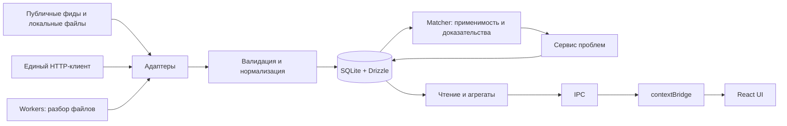

# VulnPulse Desktop

**Локальный центр управления уязвимостями для AppSec, SOC и руководителей ИБ.**

VulnPulse Desktop будет собирать сведения из NVD, OSV, CISA KEV и БДУ ФСТЭК, сопоставлять их с программным стеком организации и помогать вести работу от обнаружения до подтверждения исправления. Пользователь сможет понять, какие проблемы относятся к его компонентам, почему получено совпадение, что исправлять в первую очередь и какие сроки уже нарушены.

Основная версия — настольное приложение с локальной базой, без обязательного аккаунта и облачного сервера. Работа с сохранёнными данными должна быть доступна без интернета. Отправка сведений о пакетах во внешние API допускается только в отдельно включённом пользователем режиме.

**Состояние на 5 ноября 2026 года:** версия `0.1.0`, реализовано ядро и стартовый экран; готового пользовательского MVP пока нет. Разделы про MVP и полную версию описывают проект развития, а не доступные функции. Анализ выполнен по исходникам, тестам и документации поставщиков. Предложенные изменения схемы и поведения ещё не реализованы и не заменяют автоматически правила AGENTS.md.

## Для кого и какую задачу решает проект

| Пользователь | Основная задача |
| --- | --- |
| AppSec-инженер | Сопоставить зависимости с уязвимостями, проверить применимость и организовать исправление |
| SOC / аналитик ИБ | Найти известные эксплуатируемые уязвимости в своём стеке и проверить основания для приоритета |
| Владелец системы | Получить список затронутых компонентов, рекомендации источников и сроки устранения |
| Руководитель ИБ | Видеть актуальность данных, подтверждённые проблемы, просрочки и динамику исправлений |

Будущий сценарий: добавить компонент с версией и CPE/PURL → обновить базы → получить объяснимое совпадение → проверить применимость → перевести проблему в работу → после обновления компонента зафиксировать исправление с датой и заметкой.

Активное сканирование сети, эксплуатация уязвимостей, автоматическая установка патчей и доказательство достижимости уязвимого кода не входят в MVP. Совпадение по версии само по себе не доказывает возможность эксплуатации в конкретной среде.

## Что уже реализовано

| Область | Фактическое состояние |
| --- | --- |
| Electron | Окно, Main / Preload / Renderer, `contextIsolation: true`, `nodeIntegration: false` |
| База | `node:sqlite` + Drizzle, внешние ключи, WAL для файловой БД, семь прикладных таблиц |
| Миграции | SQL из `schema.ts`, собственный транзакционный раннер, `schema_migrations` |
| Общие типы | Enum статусов и критичности, DTO на основе insert-типов Drizzle |
| Matcher | CPE/PURL, нормализация имён, сравнение версий на равенство, устранение повторных совпадений, предупреждения |
| Тесты | 142 unit-теста в восьми файлах; конфигурация Playwright без реализованных E2E-сценариев |
| Интерфейс | Стартовый экран; API preload содержит только `ping()` |
| Фиды и фон | HTTP-клиент, адаптеры, планировщик и рабочий IPC ещё отсутствуют |

Покрытие текущего matcher не означает полную реализацию стандартов CPE/PURL и правил версий всех экосистем. Сейчас отсутствуют диапазоны версий, логические конфигурации NVD и полноценное хранение пакетных условий OSV.

## Границы MVP

Один пользователь, одно локальное рабочее пространство, один запущенный экземпляр Electron с его штатными процессами, каталог компонентов и полный ручной цикл работы с проблемой.

| Возможность | Содержание MVP |
| --- | --- |
| Инвентаризация | Добавление и изменение компонентов: тип, имя, версия, CPE/PURL; проверка согласованности версии и идентификатора |
| Источники | CISA KEV и NVD по сети; OSV в разрешённом режиме; БДУ ФСТЭК через ручной XML-импорт |
| Применимость | CPE и пакеты npm/PyPI/Maven в явно заявленных пределах поддержки; точные версии и проверенные диапазоны; отдельное отображение неопределённости |
| Рабочая таблица | Поиск, фильтры по источнику, критичности, KEV, компоненту и статусу, сортировка, постраничная загрузка, горячие клавиши |
| Карточка проблемы | Уязвимость, компонент, источники, объяснение совпадения, заметки, срок, история статусов |
| Приоритет | KEV, критичность, подтверждённая применимость и просрочка как отдельные понятные признаки |
| Синхронизация | Свежесть и охват фидов, ошибки, прогресс, отмена, ручной запуск, расписание при работающем приложении |
| Обзор | Проблемы, просрочки, критичность, KEV и свежесть источников с точными определениями показателей |
| Сохранность | Миграции с сохранением данных, резервная копия и восстановление БД |
| Поставка | Установщик и полный сценарий на первой поддерживаемой платформе; первым кандидатом является Windows |

macOS и Linux — целевые платформы архитектуры. Готовность каждой подтверждается отдельной сборкой и тестами. Планировщик MVP не работает после полного выхода из приложения; при запуске проверяет пропущенные обновления.

### Критерии готовности MVP

1. Пользователь проходит путь от ввода компонента и загрузки фида до анализа, SLA и фиксации исправления; результат сохраняется после перезапуска.
2. Повторный импорт не создаёт дубликатов. Одна CVE из CISA и NVD сохраняет оба происхождения и пользовательские заметки.
3. Неизвестные версии, повреждённые записи и неподдерживаемые условия не превращаются в заключение «безопасно».
4. Сбой сети, отмена и перезапуск не теряют рабочую базу и не продвигают курсор за необработанные данные.
5. Исправление у одного компонента не закрывает проблему у другого. Повторный матчинг сохраняет действия аналитика.
6. Проверены сетевое поведение, недоверенное содержимое, восстановление копии и запуск установленного приложения.
7. Измерена скорость на согласованном наборе данных. Предварительная цель: 1 000 компонентов, 100 000 записей источников, страница из 100 строк до 500 мс по p95 на машине с 4 ядрами, 8 ГБ RAM и SSD. Это проектный бюджет, текущих измерений нет.

## Оценка технологического стека

**Рекомендация: сохранить Electron, TypeScript, React, SQLite и Drizzle.** Они соответствуют локальному приложению с насыщенными таблицами и интеграцией с файловой системой. Главные ограничения находятся в предметной модели и обработке данных, а не требуют смены платформы.

| Решение | Оценка и условия применения |
| --- | --- |
| Electron + TypeScript | Единая кодовая база и типизированный IPC. Цена — размер поставки, память и регулярное обновление Electron/Chromium |
| React + TailwindCSS | Достаточная основа UI; shadcn/ui и lucide-react добавлять на стадии интерфейса, сохраняя доступность |
| Zustand | Фильтры, выделение и состояние UI; БД остаётся источником истины, бизнес-правила находятся в Main |
| Recharts | Агрегированные графики; расчёты выполняет сервис, Renderer получает небольшие наборы |
| SQLite / `node:sqlite` | Транзакционное локальное хранилище без сервера. Синхронные операции требуют ограниченных пакетов и контроля задержек |
| Drizzle + drizzle-kit | Типизированные запросы и схема. RC-зависимости требуют воспроизводимой установки и проверки миграций под Electron |
| Собственный раннер | Подходит для SQL внутри Main-бандла; нужны строгий порядок, неизменность применённых миграций и тесты обновления |
| Axios + единый HTTP-клиент | Общее управление лимитами, повторами, тайм-аутами и отменой; дополнительная сетевая платформа не нужна |
| `fast-xml-parser` / Cheerio | XML — основной импорт ФСТЭК; Cheerio добавлять при подтверждённой необходимости HTML-резерва |
| node-cron | Источник сигнала запуска; состояние заданий, блокировки и восстановление обеспечивает приложение |
| Vitest / Playwright | Unit-тесты дополнить интеграционными, миграционными и E2E именно Electron-приложения |
| electron-vite / electron-builder | Первый уже собирает приложение; второй планируется для установщиков, подписания и обновлений |

Drizzle документирует подключение готового `DatabaseSync` и синхронные методы query builder. Сохраняется проектное правило использовать `select`/`insert`/`update`, не опираться на RQB `db.query.*`. Совместимость проверяется на закреплённой паре версий, а не переносится автоматически на все релизы. [Drizzle: Node SQLite](https://orm.drizzle.team/docs/sqlite/connect-node-sqlite).

`DatabaseSync` выполняет операции синхронно: обёртка в `async` не делает тяжёлый запрос неблокирующим. В MVP допустимы короткие операции в Main; крупные импорты дробятся, парсинг выполняется в worker. [Node.js 24: SQLite](https://nodejs.org/download/release/v24.0.0/docs/api/sqlite.html).

## Целевая архитектура MVP

Модульный монолит: одна поставка, чёткие границы внутри Main и узкий API для UI. Для MVP не нужны отдельный веб-сервер, Redis, брокер сообщений или микросервисы.



Схема показывает обработку данных. Команды пользователя идут отдельно: `Renderer → preload → IPC → сервис → БД`; ответы и события возвращаются обратно. Это не циклические зависимости модулей: сервисы не импортируют Renderer, а результаты matcher записываются как следующий шаг конвейера.

### Границы модулей

- **Main:** окно, жизненный цикл, БД, регистрация сервисов/IPC, завершение заданий и закрытие БД.
- **HTTP-клиент:** лимиты по источнику/ключу, ограниченные повторы с exponential backoff и jitter, `Retry-After`, отмена, тайм-ауты, размеры ответов, безопасные редиректы и очистка секретов в логах.
- **FeedAdapter:** `fetchIncremental` получает страницы или локальные данные, `parse` проверяет/нормализует, `upsert` делегирует транзакционную запись сервису импорта. Адаптер не меняет статусы аналитика.
- **Синхронизация:** один запуск на источник, курсоры и коммит пакетов, прогресс. Ручной запуск и node-cron используют один путь.
- **БД / репозитории:** параметризованные запросы, транзакции, ограничения, стабильная пагинация, индексы и агрегаты.
- **Matcher:** чистые функции без SQL и сети. Кандидатов по индексам продукта/пакета выбирает сервис.
- **Сервис проблем:** объединяет автоматические сведения со статусом, заметками и SLA, сохраняя ручную работу при пересчёте.
- **IPC / preload:** конкретные методы наподобие `listFindings` и `updateFindingStatus`, runtime-валидация, проверка отправителя, ограниченные ответы и отписка от событий.
- **Renderer:** отображение, ввод и фильтры; hooks для IPC. Применимость и приоритеты вычисляются в сервисах.

## Модель данных для рабочего MVP

Текущие семь таблиц подходят для проверки ядра, но не выражают многоканальные сведения и независимую работу по компонентам. Предлагаемая модель требует новых миграций; схема ещё не изменена.

| Сущность | Назначение и связи |
| --- | --- |
| `feeds` | Настройки и состояние источника; отключение без удаления пользовательских данных |
| `sync_runs` / состояние синхронизации | Запуск, результат, счётчики, ошибка, курсор, последний полный успех и охват |
| `source_records` | Уникальность `(feed_id, source_id)`, исходный payload, версия парсера, хеш, даты и отзыв |
| `vulnerabilities` | Стабильный внутренний ID канонической уязвимости и представление для чтения |
| `vulnerability_identifiers` | CVE/GHSA/BDU и другие идентификаторы с типом и подтверждёнными связями |
| `vulnerability_sources` | Связь источников и уязвимостей; учитывает запись, относящуюся к нескольким CVE |
| `affected_rules` | Пакет/CPE, границы версий, дерево условий и ссылка на исходную запись |
| `stack` | Конкретная учётная запись компонента; разные установки нельзя сливать только по названию |
| `matches` / `findings` | Автоматический результат и рабочая проблема по паре «уязвимость + компонент», объяснение, статус, первое/последнее обнаружение |
| `notes`, `sla`, `status_history` | Работа по проблеме; общая заметка к уязвимости при необходимости хранится отдельно |
| `settings` | Версионируемые настройки; секреты отдельно защищены средствами ОС |

Принципы хранения:

1. **Источники не перезаписывают друг друга.** Сохраняются происхождение и значения; отсутствие поля у одного источника не очищает другое. Отключение фида не удаляет заметки/SLA каскадом.
2. **Объединение требует доказательств.** Явные идентификаторы и подтверждённые alias-связи; похожие заголовки, `related` и ссылки на другую CVE недостаточны. Неоднозначные записи сохраняются раздельно до разрешения связи.
3. **Статус относится к компоненту.** Одна CVE может быть `Patched` в одном месте и `Affected` в другом. Общий статус в списке уязвимостей — вычисляемая сводка.
4. **Исходные данные остаются внутри Main.** `rawJson` хранится у записи источника, не включается в списочные IPC DTO. Для XML сохраняются метаданные импорта и при необходимости ограниченная исходная копия. Нужны срок хранения и лимиты объёма.
5. **Каталог отдельно от workflow.** Отзыв записи, исчезновение условия и устаревание фида не означают `Patched` или `False Positive`.
6. **Чтение отличается от создания.** IPC получает отдельные DTO с обязательными ID и явными `null`. Нынешний `InferInsertModel` не должен автоматически стать контрактом чтения. Типовую зависимость `shared → main/db/schema` следует убрать при выделении контрактов; runtime-доступа к БД она сейчас не создаёт.

Статусы сохраняются: `New`, `Analyzing`, `Affected`, `In Progress`, `Patched`, `False Positive`. Переходы проверяет сервис; закрытие фиксирует основание, дату и версию компонента. Повторное обнаружение требует видимого пересмотра с сохранением истории.

CVSS хранится с версией, вектором и источником. Неизвестная критичность отличается от `None`. KEV — отдельный признак, а срок CISA — отдельное поле источника, не автоматически назначенный внутренний SLA.

Переход выполняется новыми миграциями с сохранением ID, записей и пользовательской истории. Перенос глобального статуса/SLA в проблемы компонентов требует явного правила, особенно если у одной уязвимости несколько совпадений. Перед миграцией — согласованная резервная копия и тест на заполненной БД; существующую пользовательскую базу нельзя считать пустой или удалять ради новой схемы.

## Источники и надёжная синхронизация

| Источник | Роль | План обработки |
| --- | --- | --- |
| CISA KEV | Известная эксплуатация и действия из каталога | Официальный JSON, ETag при поддержке сервером, 304 и полные снимки |
| NVD | CVE, оценки, конфигурации CPE | Пагинация, лимиты, начальная загрузка и инкременты по `lastModified`, исходные условия |
| OSV | Уязвимости пакетов | Онлайн: `/v1/querybatch` и подробности; локально: импорт/зеркало публичных наборов и собственный matcher |
| БДУ ФСТЭК | Сведения БДУ и внешние идентификаторы | XML-импорт с проверкой формата, worker и протоколом ошибок; авто-загрузка вторична |

KEV не даёт готовых CPE-диапазонов: его схема содержит CVE, продукт, описание и действия. Связывать KEV нужно с CVE других источников, не выводить точное совпадение из названия продукта. [Официальная схема CISA KEV](https://raw.githubusercontent.com/cisagov/kev-data/main/known_exploited_vulnerabilities_schema.json).

OSV batch API возвращает сокращённые сведения (`id`, `modified`) и отдельные токены пагинации для запросов. Подробности загружаются через `/v1/vulns/{id}` и кэшируются. [OSV querybatch](https://google.github.io/osv.dev/post-v1-querybatch/), [OSV details](https://google.github.io/osv.dev/get-v1-vulns/).

Лимит NVD по принятому проектному требованию — 5 запросов за 30 секунд без ключа и 50 с ключом. Его нужно сделать конфигурируемым и повторно сверить перед реализацией: страницы NVD при анализе 2026-11-05 не отдали читаемое содержимое. Также проверить актуальные пределы окон дат и пагинации. [NVD: начало работы](https://nvd.nist.gov/developers/start-here), [CVE API](https://nvd.nist.gov/developers/vulnerabilities).

Общий алгоритм:

1. Зафиксировать запуск и границы окна, получить блокировку источника. Не держать SQL-транзакцию во время сети.
2. Загрузить ограниченный пакет, проверить структуру/размер и нормализовать. Повреждённые записи учитываются в отчёте.
3. В короткой транзакции сохранить записи, связи и checkpoint пакета. ETag применённого снимка обновить только после успешного применения снимка.
4. Пересчитать затронутые проблемы. Сохранить revision данных и состояние пересчёта, чтобы UI отличал актуальные результаты от ожидающих matcher.
5. Курсор полного успеха продвигать после обработки всего окна. Перекрывающиеся окна и идемпотентные upsert защищают от повторов и поздних обновлений.

При неполной загрузке нельзя считать исчезнувшие записи отозванными. UI показывает фактический охват: частичная загрузка или ограниченный период не равны отсутствию уязвимостей вне набора. Загрузки только недавних публикаций недостаточно для старых версий ПО.

## Матчинг и достоверность

Целевой результат: **совпадает**, **не совпадает в рамках проверенного условия**, **не удалось определить**. Он отделён от ручного статуса. Отсутствие версии, неизвестный формат или неполные данные сопровождаются причиной неопределённости.

- **CPE:** различать ANY / NA / литерал, учитывать экранирование и направленность. Нужны границы диапазонов и логические конфигурации NVD; плоский список теряет условия окружения. Неподдержанное условие даёт неопределённость. Нельзя удовлетворять `AND` компонентами с разных машин без контекста установки. [Спецификации CPE](https://csrc.nist.gov/projects/security-content-automation-protocol/specifications/cpe).
- **PURL:** разделять идентичность, версию и значимые qualifiers. Противоречие между отдельной версией и CPE/PURL отклонять или явно исправлять.
- **Версии:** SemVer подходит для SemVer; PyPI и Maven имеют собственные правила. Общий нормализатор не является универсальным компаратором. Нужны отдельные стратегии с тестами; неподдержанные варианты остаются неопределёнными. [Python versions](https://packaging.python.org/en/latest/specifications/version-specifiers/), [Maven ordering](https://maven.apache.org/pom.html#Version_Order_Specification).
- **OSV:** сохранять явные версии, тип диапазона, включительность границ и отзыв записи. `GIT` без репозитория/коммита не оценивать как обычную строку версии. [OSV schema](https://ossf.github.io/osv-schema/).
- **Объяснение:** источник, условие, версия компонента, результат, дата и версия matcher. Текущие confidence `1.0` / `0.8` — эвристические веса, не вероятности.
- **Производительность:** сначала кандидаты по продукту/пакету, затем правила; пересчёт только затронутых компонентов, без постоянного полного перебора каталога.

Поддержка npm/PyPI/Maven объявляется после проверки правил версий: распознавания PURL недостаточно. Неподдержанные условия видны аналитику и учитываются в метриках качества данных.

## Локальность и безопасность

Локальная БД не делает любой сетевой сценарий приватным. Запрос OSV с именем/версией/PURL раскрывает эти поля оператору API; фильтры NVD по стеку также могут раскрывать интерес к компонентам. Это вывод из состава запросов.

| Предлагаемый режим | Сетевое поведение |
| --- | --- |
| Полностью автономный | Сеть отключена; локальный каталог и ручной импорт |
| Локальный анализ с обновлением публичных баз — рекомендуемый по умолчанию | Общие наборы без отправки стека; сервисы всё равно видят IP и выбранные наборы/экосистемы |
| Онлайн-проверка пакетов | Явное разрешение отправлять идентификаторы/версии в OSV; внутренние имена систем, заметки и сведения об активах не включаются |

OSV предоставляет выгрузки для локального использования. В MVP можно начать с ручного импорта поддерживаемого набора, затем автоматизировать зеркало. Этот импорт ещё предстоит реализовать. [OSV: downloadable database](https://google.github.io/osv.dev/faq/).

До поставки MVP нужно включить sandbox Renderer, ограничить навигацию и внешние URL, задать CSP и проверять отправителя IPC. Сейчас в `src/main/index.ts` задан `sandbox: false`, `shell.openExternal()` получает непроверенный URL, CSP в HTML отсутствует. Усиление нужно до показа недоверенных фидов. [Electron security](https://www.electronjs.org/docs/latest/tutorial/security).

Требования проекта: содержимое фидов не исполняется; импорт имеет лимиты размера, глубины и времени; worker разгружает поток, но не является защитной песочницей. API-ключ хранится с защитой ОС и не попадает в логи/DTO. Обычная SQLite не шифрует БД автоматически; требование шифрования всей базы согласуется отдельно.

## Полная версия и масштабирование

Полная настольная версия развивает то же ядро:

- **Организация:** несколько рабочих пространств, активы/сервисы, окружения, владельцы и критичность, отдельные установки одинакового пакета.
- **Инвентарь:** SBOM CycloneDX/SPDX, затем коннекторы; происхождение и дата наблюдения, контроль исчезнувших и устаревших компонентов.
- **Точность:** расширенные компараторы, условия окружения, проверенные CPE/PURL-реализации, при необходимости VEX и исключения с основанием/сроком.
- **Приоритет:** KEV, CVSS, при необходимости EPSS, доступность актива и бизнес-критичность. Пользователь видит источник, время и формулу оценки.
- **Процесс:** владельцы, журнал изменений, политики SLA, повторное открытие, пакетные действия, отчёты и экспорт.
- **Надёжность:** возобновляемые задания, диагностика, копии и проверка восстановления, контроль версии схемы, подписанные обновления, политика хранения.
- **Поставка:** CI на целевых ОС, установщики, тест обновления предыдущей версии, лицензии зависимостей и данных.

Для больших каталогов предлагается выделить владельца SQLite в worker или utility process под управлением Main. Обмен — асинхронными командами; один владелец записывает БД, вычислительные workers обрабатывают ограниченные снимки. Объект `DatabaseSync` между потоками не передаётся. Это будущее изменение размещения сервисов, требующее отдельной проверки Electron/сборки; в MVP БД остаётся в Main.

Интерфейсы сервисов позволят вынести реализацию без переписывания UI. Сначала нужны измерения памяти, задержек БД/IPC и пересчёта; преждевременное дробление на сетевые сервисы не требуется.

### Возможное расширение для совместной работы

Командная серверная редакция — отдельное расширение: локально развёртываемый backend, серверная БД (кандидат — PostgreSQL), аутентификация/SSO, роли, аудит и централизованная синхронизация. Desktop сможет стать клиентом с кэшем; понадобятся разрешение конфликтов и политика размещения данных.

Общая сетевая папка с файлом SQLite не заменяет такую архитектуру. Обещание «данные только на этом компьютере» не переносится на серверный режим. Backend, PostgreSQL и облачная синхронизация сейчас не приняты в обязательный стек.

## Технические пробелы и порядок устранения

| Когда | Наблюдение по коду | Предлагаемое действие |
| --- | --- | --- |
| До CISA/NVD | Один `feedId`, уникальный `extId`, удаление фида каскадно удаляет зависимые данные | Записи источников и связи; пользовательский контекст независимо от фидов |
| До полноценного matcher | Нет пакетных диапазонов и дерева конфигураций; только равенство | Нормализованные условия, диапазоны и неопределённость |
| До OSV | Обещание не передавать стек противоречит querybatch по PURL | Явные режимы приватности |
| До IPC | Insert-модели в DTO и зависимость shared от типов Main | Отдельные контракты чтения, команд, ошибок и событий |
| До Notes/SLA | Статус и SLA привязаны к уязвимости целиком | Рабочая проблема на компоненте, история, повторное обнаружение |
| До показа фидов | Отключён sandbox, непроверенные внешние ссылки, нет CSP | Усиление Electron и обработки содержимого |
| До выпуска | Нет E2E, backup и проверки установленного обновления | Полный цикл, восстановление, миграции |
| Перед ростом | Полный перебор matcher, синхронная БД в Main | Индексы кандидатов, пакеты, измерения, затем DB worker при необходимости |

Дополнительно: уникальность `(vendor, product, version)` не задаёт идентичность установки и содержит nullable-поля; `updatedAt` имеет только default и не обновляется автоматически. У миграций нет контрольных сумм. Coverage настроен на `services/**`, но обязательный порог 100% не задан; unit-тесты не входят в текущие tsconfig для typecheck. Эти детали ещё не исправлены.

В matcher также есть конкретные ограничения: отдельное поле `StackItemForMatch.version` не используется при сопоставлении — версия берётся из CPE/PURL; CPE-парсер разрешает ограниченный набор экранирования; qualifiers PURL не участвуют в текущем ключе идентичности. Нужны согласование входных полей и нормативные тестовые наборы перед расширением заявленной поддержки.

## План реализации

Сохраняется порядок стадий; уточнения модели встраиваются в соответствующие пункты. Переход: реализация → typecheck/tests/coverage/build → отчёт → подтверждение пользователя.

1. **HTTP-клиент:** тайм-ауты, отмена, лимиты и повторы, тесты без реальной сети.
2. **Контракт адаптера:** модель записей источников, `rawJson`, курсоры, миграции и сохранение пользовательских данных.
3. **CISA KEV:** каталог и обогащение по CVE; повторный импорт и условный HTTP-запрос.
4. **NVD:** начальная загрузка, инкременты, пагинация; CPE-условия и расширения matcher.
5. **OSV:** режимы приватности, пакетные условия, детали записей и компараторы.
6. **ФСТЭК:** проверенный XML, worker, ручной импорт, ошибки и повторная загрузка.
7. **Планировщик:** единый путь заданий, блокировки, восстановление и догоняющая синхронизация.
8. **IPC / preload:** контракты и runtime-валидация; сервисы проблем, настроек, заметок и SLA.
9. **UI:** таблица → Dashboard → Stack → Notes/SLA → Settings; защита до отображения фидов.
10. **Поставка MVP:** копии/восстановление, E2E, установщик, проверка миграций, производительности и сети.

Модели, режимы приватности и перенос БД — рекомендации анализа. Реализация изменений согласуется на соответствующем пункте; существующий код в рамках этого документа не менялся.

## Структура репозитория

```text
src/
  main/
    index.ts                      # жизненный цикл Electron
    db/
      index.ts                    # node:sqlite + Drizzle
      schema.ts                   # источник правды схемы
      migrations/                 # SQL, реестр и раннер
    services/
      matcher/                    # существующее ядро
      httpclient.ts               # запланировано
      feeds/                      # запланировано: адаптеры и workers
      scheduler.ts                # запланировано
      findings/                   # предлагаемое расширение
    ipc/                          # запланировано
    utils/                        # инфраструктурные помощники
  preload/                        # сейчас только ping
  renderer/src/                   # сейчас стартовый экран
  shared/                         # enum и типы; далее IPC-контракты
tests/
  unit/                           # существующие тесты
  e2e/                            # запланированные сценарии
electron.vite.config.ts
drizzle.config.ts
vitest.config.ts
playwright.config.ts
```

## Разработка и проверки

Среда анализа: Windows, Node.js `24.21.0`, npm `11.19.0`. Для разработки используется Node 24; выполнение отдельно проверяется под поставляемым Electron. Версии из `package-lock.json`, не утверждение о последних релизах:

| Зависимость | Версия в lockfile |
| --- | --- |
| Electron | 45.0.0 |
| Drizzle ORM / drizzle-kit | 1.0.0-rc.5 / 1.0.0-rc.5 |
| React | 19.3.1 |
| TypeScript | 5.9.3 |
| Vite | 7.3.7 |
| Vitest | 4.1.12 |
| semver | 7.8.5 |

Axios, fast-xml-parser, Cheerio, node-cron, Zustand, Recharts, lucide-react и electron-builder пока не установлены; компоненты shadcn/ui ещё не добавлены.

```bash
npm ci
npm run dev
npm run typecheck
npm test
npm test -- --coverage
npm run build
npm run db:generate
```

`npm ci` использует lockfile; обновление зависимостей выполняется осознанно. В npm 11 учитывать разрешения install-скриптов Electron/esbuild из `package.json.allowScripts`. Не удалять lockfile как обычный способ установки.

`db:generate` создаёт SQL из схемы; миграцию нужно проверить и включить в `src/main/db/migrations/index.ts`. Генерация сама не применяет миграции. Применённые SQL-файлы не переписываются.

БД — `vulnpulse.db` в Electron `userData`; для текущей Windows-конфигурации журнал указывает `%APPDATA%\VulnPulse Desktop`. Копия должна быть согласованной с WAL: поддерживаемый backup или закрытая БД, а не копирование только основного файла во время записи.

**Проверено 2026-11-05:**

- `npm run typecheck` — успешно для Main/Preload и Renderer.
- `npm test -- --coverage` — 142/142, восемь файлов; statements 316/316, branches 197/197, functions 41/41, lines 305/305 — 100% текущего matcher.
- `npm run build` — успешны Main, Preload и Renderer.
- Первый запуск тестов не дошёл до выполнения из-за `EPERM` при переименовании временных файлов; повтор с разрешённым доступом прошёл.
- GUI, установщики, E2E, нагрузочные сценарии и свежий `npm audit` здесь не запускались. Скрипт `npm run e2e` уже объявлен, пользовательские E2E ещё не реализованы.

Будущие проверки: реальные форматы, граничные версии, повреждённые импорты, повторы, 304/429/5xx, отмена/возобновление, миграции с заметками/SLA и сетевое поведение режимов приватности. Unit-покрытие их дополняет, но не заменяет.

## Документация и статус решений

README — переносимое описание продукта и архитектуры в Git. В локальной рабочей папке рядом с репозиторием находятся `AGENTS.md` и `PROJECT_MEMORY.md`: правила, подробный анализ и история проверок. Они лежат вне корня Git-репозитория и не включаются в коммит README.

Зафиксированные технологии сохраняются. Предложения документа — основа следующих задач, не утверждение о завершённой реализации. Лицензия проекта пока не указана; перед публичной поставкой нужно определить её и проверить условия использования/перераспространения исходных данных.
