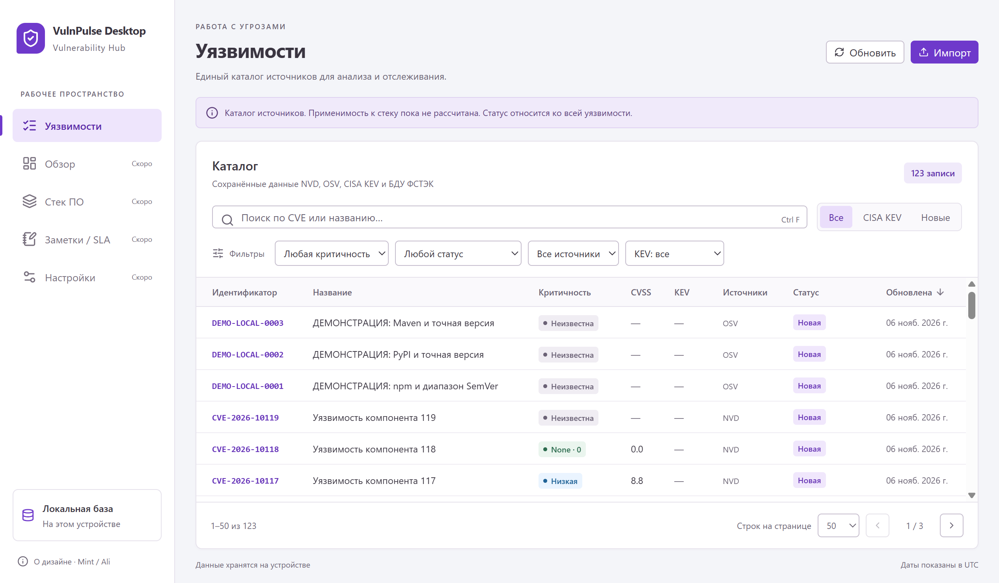

# Оболочка Mint и каталог уязвимостей

Реализовано 2026-11-07 по запросу «продолжи разработку»: первый пункт стадии 7. Экран заменяет стартовую заглушку. Актуализация 2026-11-08: [Обзор](dashboard-ui.md) подключён вторым пунктом; [Стек ПО](stack-ui.md) также подключён; [Заметки / SLA](workflow-ui.md) также подключены; пока недоступен только экран Настройки.

Снимок — синтетические данные тестового профиля, включая демонстрационные advisory; это не реальный контур и не результат live-синхронизации.

## Что доступно

- Таблица канонических уязвимостей: идентификатор, название, критичность, CVSS, KEV, источники, общий статус и дата обновления. Одна CVE не превращается в несколько строк из-за нескольких источников.
- Поиск в идентификаторе/названии с debounce 250 мс и ограничением 200 символов. `%`, `_`, `!` передаются как текст: SQL-экранированием занимается существующий Main-сервис.
- Фильтры severity, общего статуса, источника и KEV; быстрые действия «Все», «CISA KEV», «Новые». Неизвестная severity (`null`) отличается от `None`; нулевой CVSS показан как 0.0, отсутствие значения — отдельно.
- Сортировка критичности и даты обновления с accessible `aria-sort`. Порядок и tie-breaker вычисляет Main. Идентификатор не выдаёт сортировку по внутреннему числовому ID за алфавитную сортировку CVE.
- Страницы по 25/50/100 строк, общий счёт из того же IPC-ответа; смена фильтра/сортировки/размера сбрасывает offset. Если запись ушла с последней страницы, UI возвращается на существующую страницу. Ограничение offset остаётся прежним: 1 000 000.
- Боковая карточка: описание, severity/CVSS/vector, KEV, источники и даты UTC. Флаги обрезки Main явно показаны. HTML-подобные строки выводятся текстом, ссылки/HTML из фидов не исполняются и не становятся внешними переходами.
- Изменение общего рабочего статуса через `vulnerabilities.setStatus`. До успешного ответа нет оптимистичного успеха; при ошибке сохраняется введённый статус и доступно повторное чтение карточки. Ошибка транспорта не объявляется доказательством отката. После подтверждения таблица обновляется; карточка сохраняет свой идентификатор, даже если смена статуса убрала строку из текущего фильтра.
- Локальный импорт OSV JSON и XML/XML.GZ ФСТЭК из кнопки «Импорт». Файл выбирает Main через прежний контроллер; пути не передаются из Renderer. Отдельный формат инвентаря ПО по-прежнему импортируется через нативное меню.

Применимость к стеку не рассчитывается экраном и не выводится из наличия записи в каталоге. Статус принадлежит всей уязвимости, а не отдельному компоненту; смена статуса не проставляет `patchedAt` в SLA. Предупреждение об этих границах видно в каталоге/карточке. Текст «Локальная база» описывает хранение; он не означает глобального запрета сетевых обновлений Main.

## Состояние UI и запросы

`store/catalog.ts` использует Zustand и содержит только запрос/сортировку/страницу, выбранный ID и ревизию перечитывания. В БД и matcher Renderer не обращается; каталог не копируется целиком в store.

`useVulnerabilities` и `useVulnerabilityDetail` вызывают только публичный `window.electronAPI`. `useApiResource` снимает жизненный цикл старого запроса и игнорирует его поздний ответ; строки другого запроса не отображаются как результат нового фильтра. IPC не поддерживает физический abort чтения, поэтому отменяется применение ответа. Запись статуса завершается в Main и после закрытия карточки; поздний ответ обновляет каталог, но не подменяет данные новой карточки.

`useCatalogActivity` последовательно опрашивает `sync.status`: через 3 секунды в покое, через 1 секунду при активной операции, с cleanup timer при размонтировании. Это локальный IPC, а не внешний HTTP. Завершение операции меню/API/cron вызывает перечитывание каталога, включая ошибку/отмену NVD с потенциально уже применёнными страницами. Количественного прогресса, сохранённой истории импортов и IPC-событий пока нет.

Активный импорт/синхронизация показывается полосой состояния с адресной отменой. Ошибка импорта видна отдельно; подтверждённая запрошенная отмена — как «Импорт отменён». Нативный файловый диалог не закрывается через AbortSignal: до его ручного закрытия действует прежняя блокировка. Ошибки UI показывают постоянные безопасные тексты по коду, без provider/SQL/credential messages.

Загрузка, пустая база, пустой результат фильтра, ошибка с повтором и недоступность команды различаются. Запросы/фильтры живут в памяти UI; после перезапуска UI возвращается к исходным фильтрам, данные и рабочий статус сохраняются в SQLite.

## Дизайн и доступность

Токены светлой темы основаны на [DESIGN.md](../DESIGN.md): `#F4F5F9`, белая поверхность, `#6E39CB`, `#DECCFE`, `#3A3541`. Вторичные подписи и смысловые badge-цвета адаптированы для плотного интерфейса. Шрифт — локальный Segoe UI/system-ui с кириллицей, сетевые шрифты/изображения отсутствуют. Radix Dialog управляет modal/focus trap; кнопка, input, native select и таблица остаются семантическими HTML-controls. Primitive/Button/Dialog адаптированы из shadcn/ui; CLI и полный набор компонентов не устанавливались.

Проверены Tab/Enter, Ctrl+F (и `/` вне редактируемых полей), Escape с возвратом к открывшей кнопке, а после удаления строки — к поиску. Модальная карточка удерживает фокус. Иконки с текстовыми подписями скрыты от screen reader; свернутая навигация сохраняет accessible names. Контуры focus видимы, смысл badges продублирован текстом; `prefers-reduced-motion` учитывается. Это не полный WCAG-аудит или проверка реальным screen reader.

При ширине около 1024 px таблица прокручивается в своей области; при масштабе 125–150% боковая навигация сворачивается в иконки, controls переносятся, workspace доступен вертикальной прокрутке. Минимальный размер окна не закреплялся. Проверка Windows учла округление DPI ±1 CSS pixel; это не изменение размеров проекта на другую платформу.

Материалы/лицензии и характер адаптации перечислены в [THIRD_PARTY_NOTICES.md](../THIRD_PARTY_NOTICES.md) и «О дизайне» внутри приложения. Точное соответствие неизвлечённым слоям/variables Figma не заявляется.

## Зависимости и первичные источники

Установлены точные версии: Zustand 5.1.0, lucide-react 1.70.0, @radix-ui/react-dialog 1.3.1, class-variance-authority 0.7.1, clsx 2.1.1, tailwind-merge 3.7.0. npm добавил 30 пакетов; install-скрипты отключены. Electron/React/Drizzle не обновлялись, lockfile сохранён. npm install сообщил 0 уязвимостей; упаковочный аудит/обновление всего стека не выполнялись.

Сверены Context7 и первичные [Zustand TypeScript](https://github.com/pmndrs/zustand/blob/main/docs/learn/guides/advanced-typescript.md), [миграция v5 и стабильные selectors](https://github.com/pmndrs/zustand/blob/main/docs/reference/migrations/migrating-to-v5.md), [shadcn manual](https://ui.shadcn.com/docs/installation/manual), [исходник Dialog](https://github.com/shadcn-ui/ui/blob/main/apps/v4/registry/new-york-v4/ui/dialog.tsx), [Radix Dialog](https://www.radix-ui.com/primitives/docs/components/dialog), [Lucide React](https://lucide.dev/guide/react/). Отдельного снимка Zustand 5.1.0 в Context7 нет: использован ближайший 5.0.14, затем сверены установленные types и реальный React/Electron runtime.

## Фактические проверки

- `npm run typecheck` Main/Preload/Renderer и `npm run build` — успешны.
- Полный Vitest+coverage — **855/855**, 29 файлов. Matcher — все 100%; services 88,13% statements / 86,77% branches / 94,50% functions / 91,00% lines. Include остался `src/main/services/**`: проценты не измеряют покрытие UI, IPC/preload или собранного XML worker.
- Полный Electron E2E — **12/12**, 17,7 с: 9 прежних и 3 новых сценария `catalog-ui.spec.ts`. Реальные production UI/preload/IPC/services/SQLite, отдельные удаляемые профили, OSV-импорт и синтетический каталог из 123 записей. В новых сценариях внешняя Node HTTP/HTTPS сеть запрещена; подменены native dialogs, контролируемые отказы/задержки IPC-ответов.
- UI-сценарии: импорт и auto-refresh после меню, фильтры/KEV/несколько источников, `null` vs `None`/0, литеральный поиск, сортировка, страницы и сброс offset, длинные/обрезанные строки, HTML/XSS-текст, фокус/клавиатура, запись/restart, исчезновение строки из фильтра после сохранения, ошибки list/get/write, поздние ответы list/get/write, ошибка файла и отмена выбора без применения данных, атрибуция.
- Снимки обычного окна, карточки и ширины около 1024 px просмотрены. Масштабы 125% и 150% проверены геометрией/доступностью controls; на 150% использован нативный `webContents.capturePage`, поскольку Playwright дал обрезанный zoom-снимок. Снимки и сбои тестовых ожиданий не были ошибочно объявлены успешными: исправлены Windows DPI expectation и отсутствовавший тестовый import `resolve`, затем полный прогон прошёл.

Рабочая БД не использовалась. Live-фиды, реальный ключ, macOS/Linux UI, 100 000 записей/p95, installer и backup/restore этим шагом не проверялись. Автоматический matcher/assessments и независимые статусы компонентов остаются будущими задачами.

После этого шага следующим был Dashboard; он реализован 2026-11-08, см. [Обзор](dashboard-ui.md). Стек ПО затем подключён (см. [отчёт](stack-ui.md)); интерфейс заметок/SLA также [реализован](workflow-ui.md), текущий следующий пункт — Настройки. Результаты проверок выше относятся к исходному шагу 7.1; свежие — в отчёте Обзора.
