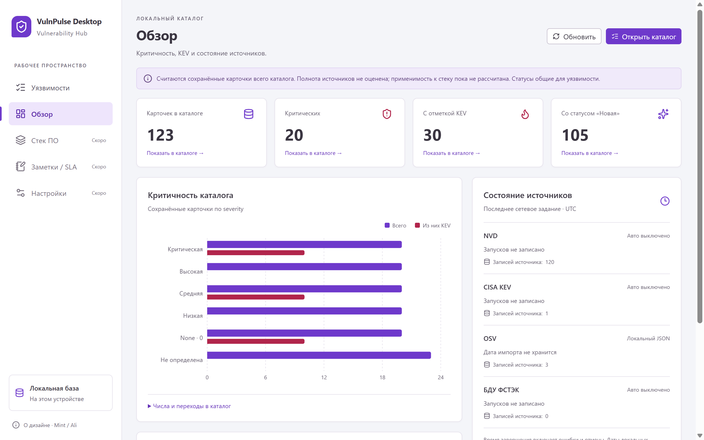

# Обзор локального каталога

Реализовано 2026-11-08 по запросу «продолжи проект»: второй пункт Renderer. Следующим был экран «Стек ПО»; он также [реализован](stack-ui.md) 2026-11-08. Интерфейс заметок/SLA также [реализован](workflow-ui.md); текущий следующий пункт — Настройки. Каталог остаётся стартовым экраном; «Обзор» доступен в боковой панели.

Снимки созданы в отдельном тестовом профиле: локальный OSV demo и синтетические карточки. Это не рабочий контур и не результат live-синхронизации.

## Показатели и переходы

Единица счёта — **сохранённая каноническая карточка** (`vulnerabilities`), как в таблице каталога. Обзор охватывает весь локальный каталог, без периода и фильтров текущей таблицы. Несколько источников одной карточки не умножают число через JOIN. Общие показатели включают исправленные и ложные срабатывания; статус относится ко всей уязвимости.

| Показатель | Определение и фильтр каталога |
| --- | --- |
| Карточек в каталоге | Все сохранённые карточки, переход без фильтров |
| Критических | `severity = Critical` |
| С отметкой KEV | `isKnownExploited = true`, независимо от severity/статуса |
| Со статусом «Новая» | `status = New`; рабочий статус, а не возраст публикации |
| Критичность | Все пять severity и отдельная группа `null`; `None` отличается от неизвестной |
| Общие статусы | Все шесть `VulnStatus`, включая нулевые группы |

На графике «Из них KEV» — подмножество «Всего», столбцы не складываются. Точные значения и переходы по severity и сочетанию severity/KEV есть в раскрываемой таблице. KPI, таблица и статусы сбрасывают прежние фильтры, поиск, offset и выбранную карточку. Обычный возврат через sidebar сохраняет запрос каталога.

Пустой успешный ответ показывает нули и предложение импорта. Ошибка показывает безопасное сообщение/повтор без подстановки нулей. Полнота фидов явно не оценена: сохранённый поднабор/частичный импорт не выдаются за полный охват. Применимость к стеку не рассчитана. SLA, тренды, независимые состояния компонентов и автоматический matcher не добавлены.

## Источники и время

Для NVD/CISA/ФСТЭК Main возвращает режим расписания, состояние последнего сетевого задания и даты начала/завершения. Выполнение, ошибка, отмена, прерывание, отсутствие истории и неоднозначная хронология различаются. «Завершено без ошибки» означает результат задания, а не полноту базы. `lastFinishedAt` учитывает неуспешные попытки; предыдущая успешная дата отдельно не хранится. При запуске scheduler обнуляет дату окончания последней попытки.

OSV остаётся локальным JSON: даты импортов не персистентны и показаны как неизвестные. Локальный импорт ФСТЭК также не входит в историю сетевых заданий. В карточках явно подписаны **записи источника** (`source_records`), которые могут отличаться от числа канонических карточек. Legacy-карточка без source record учитывается в KPI, но не в этом отдельном счётчике. Порог «свежести» не выдумывается. Даты показаны в UTC.

## Контракт и обновление

`window.electronAPI.dashboard.get()` → `ApiResult<DashboardView>`: время снимка, четыре KPI, шесть групп severity, шесть статусов, четыре карточки источников. Метод не принимает payload; Main отклоняет неизвестный ввод. DTO — в `shared/api.ts`, без Electron/Drizzle/raw. Фиксированный канал `vulnpulse:dashboard:get` использует прежний guard главного окна/frame/document и снимается до закрытия БД.

`services/dashboard.ts` выполняет read-транзакцию: SQL GROUP BY канонических карточек, подсчёт записей источников и безопасный статус SyncService. Записи/миграции/сеть/запуск matcher не добавлены. Renderer получает готовые числа и сопоставляет подписи. Ключи, raw, source URL, ETag и checkpoint не возвращаются.

Прежний последовательный polling sync.status (1 с во время задания / 3 с в покое) замечает завершение меню/API/cron, включая отмену/частичный сбой. Обзор перечитывается по завершению и изменению состояния источников. «Обновить» перечитывает локальную БД. Возврат после записи статуса получает новый снимок. Cleanup `useApiResource` игнорирует поздние ответы после ухода. Снимок подписан временем, сбой polling показан отдельно. IPC events и числовой прогресс не вводились.

## UI и зависимости

Сохранена основа Mint: четыре KPI, график/статусы слева, источники справа. До 1150 CSS px сетка одноколоночная, до 740 px KPI по два. Focus/skip-link учитывают раздел. График поддерживает клавиатуру и tooltip, имеет title/desc и таблицу точных чисел. Анимация столбцов отключена; reduced-motion сохранён.

Добавлены exact `recharts@3.10.1` и `react-is@19.3.1`, совпадающий с установленным React по [официальной инструкции](https://github.com/recharts/recharts/blob/v3.10.1/README.md). [Accessibility Recharts 3](https://github.com/recharts/recharts/blob/v3.10.1/storybook/stories/API/Accessibility.mdx) сверена через Context7 этой версии; README — также Firecrawl. Типы проверены локально, поведение — Electron. npm добавил 37 пакетов с отключёнными install-скриптами и сообщил 0 уязвимостей (243 пакета). Отдельный npm audit не запускался; Electron/React/Drizzle не обновлялись.

React.lazy загружает SeverityChart при непустом обзоре. Production build: отдельный chunk 851,47 kB, начальный renderer JS 923,03 kB; это размеры вывода electron-vite, не замеры времени/памяти. Recharts — MIT; ссылка добавлена в THIRD_PARTY_NOTICES.

## Проверки 2026-11-08

- Typecheck Main/Preload/Renderer и production build успешны после финальных UI-изменений.
- Полный Vitest+coverage: **874/874**, 30 файлов. DashboardService и matcher — 100% всех четырёх метрик. Services: 88,30% statements / 87,04% branches / 94,71% functions / 91,12% lines. Scope прежний `src/main/services/**`: UI/IPC/preload и собранный XML worker не входят в эти проценты.
- Unit: все группы совпадают с настоящим сервисом каталога; `null`/`None`/0, несколько source links/CVE aliases, legacy без links, отсутствие записей при чтении, неверный payload, состояния заданий и безопасный DTO. IPC/preload — guard/фиксированный метод/транспортная ошибка.
- Финальный полный Electron E2E: **14/14**, 23,9 с. Два новых сценария `dashboard-ui.spec.ts`: пустая БД, OSV-импорт через меню/auto-refresh, 123 карточки с несколькими источниками, KPI и переходы с очисткой поиска, severity/null/None/KEV/статусы, обновление после записи, keyboard chart, error/retry, поздний ответ после ухода, failed job с датой завершения, отказ другому окну с тем же preload. В новых сценариях Node HTTP/HTTPS запрещён, native selector и контролируемые IPC-отказы/задержки подменены.
- Просмотрены финальные снимки около 1280×800, 1024×768 и native capture при 150%; нет внешней горизонтальной прокрутки, источники доступны при вертикальной. Windows DIP округляется ±1 px. Снимки: `docs/design/screenshots/dashboard-*.png`.

Sandbox-запуск Vitest не дошёл до тестов из-за известного EPERM rename Vite-cache; разрешённый прогон успешен. npm DNS был недоступен в ограниченной среде; установка с разрешённой сетью прошла. Автоматических отклонений approval не было.

Рабочая БД не открывалась. Live feeds, реальный ключ, другие ОС, 100k/p95, backup/restore и установщики не проверялись. Коммит/push не создавались, прежние изменения сохранены.
