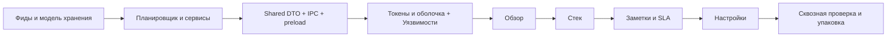

# План интеграции Mint в VulnPulse Desktop

Дата: 2026-11-05. Основание: запрос пользователя добавить план интеграции выбранного фронтенда в проект. Визуальная основа — [Mint / Free Admin Dashboard UI Kit](https://www.figma.com/community/file/1244293267600418871), описание и локальные превью — в [DESIGN.md](../DESIGN.md).

Статус: план подготовки и реализации. Выбор Mint подтверждён пользователем; предложенные ниже контракты, компоненты и решения модели ещё не реализованы и не утверждают автоматически изменения архитектуры.

Актуализация 2026-11-08: фиды/планировщик и все пять запланированных пунктов IPC реализованы: [каталог](vulnerability-api.md), [стек](stack-api.md), [заметки/SLA](workflow-api.md), [Settings/ключ NVD](settings-api.md), [sync/import](sync-api.md). Есть DTO/валидация/ревизии, защищённый ключ и сохранённые opt-in расписания, sandbox/CSP/guard, общие операции меню/API/cron. Workflow глобальный; findings не добавлены. Первые четыре пункта Renderer реализованы: [оболочка Mint и каталог](catalog-ui.md), фильтры/детали/общий статус/локальный импорт. [Обзор](dashboard-ui.md) добавляет агрегаты Main, Recharts, статусы источников и переходы в каталог. [Стек ПО](stack-ui.md) добавляет CRUD/импорт/формы CPE-PURL и обработку конфликтов; автоматический matcher/переход к связанным уязвимостям пока недоступны. [Заметки / SLA](workflow-ui.md) подключены для всей уязвимости: формы/ревизии/UTC/переходы и состояния Main. Свежие проверки — 892 unit и 21 Electron E2E. Следующий пункт — экран Настройки. Автопересчёт matcher, persistence assessments, события и числовой прогресс впереди; status доступен polling. Ниже исходный анализ 2026-11-05 сохраняется как основание плана.

## 1. Исходное состояние и результат

Проверено по коду 2026-11-05:

- Electron открывает окно 1280 × 800. React и Tailwind уже подключены; `App.tsx` содержит стартовый экран, `main.css` — базовые стили.
- Preload предоставляет только `window.electronAPI.ping()`. Прикладные IPC-обработчики, hooks и Zustand-store предстоит создать.
- Есть БД, matcher и HTTP-клиент; фиды и планировщик ещё предстоят. Общие DTO сейчас выведены из insert-моделей Drizzle.
- shadcn/ui, lucide-react, Zustand и Recharts ещё не подключены. Имеется конфигурация Playwright без готовых пользовательских E2E.
- В текущей БД статус, заметки и SLA относятся к уязвимости, а не к паре уязвимость/компонент. Модель findings из архитектурного анализа пока является предложением.

Целевой результат: единая светлая оболочка Mint с разделами «Уязвимости», «Обзор», «Стек», «Заметки / SLA», «Настройки», работающая с локальными данными через IPC. Внешний вид адаптируется к плотным таблицам и сценариям AppSec; образцы выручки и продаж заменяются предметными показателями.

## 2. Порядок и зависимости

Сохраняется последовательность AGENTS.md: **адаптеры → планировщик → IPC/preload → Renderer → упаковка**. После пяти пунктов IPC и первых четырёх экранов текущий ближайший пункт — Настройки. Этот план сам по себе не начинает реализацию следующего пункта.



Каждый программный пункт: реализация → typecheck/tests/coverage/build → отчёт → подтверждение пользователя перед следующим пунктом. Документация плана не заменяет это правило.

### Решения, необходимые до закрепления UI-контрактов

| Решение | Предложение | Где закрыть / что зависит |
| --- | --- | --- |
| Единица рабочего статуса | Использовать finding для пары vulnerability/stack, каталог уязвимостей хранить отдельно | При уточнении модели до IPC; зависят изменение статуса, заметки, SLA и единицы KPI. Потребуются отдельное согласование и миграции |
| Несколько источников одной CVE | Сохранять происхождение и независимые записи источников | На base/модели импорта и CISA; влияет на колонки источников и карточку |
| Применимость и неполные данные | Возвращать результат с объяснением и явно обозначать неопределённость | На NVD/OSV и matcher; UI не выводит «не затронут» из отсутствия данных |
| Режимы сети и OSV | Сервис должен явно сообщать разрешённые операции и возможную передачу идентификаторов пакетов | До OSV; Settings отражает принятую политику, а не создаёт её самостоятельно |
| Финальные параметры дизайна | Уточнить шрифт, семантические цвета, плотность и поведение узкого окна | В начале Renderer по DESIGN.md и доступным страницам Figma |

До решения первого пункта не закреплять команды статуса/заметок/SLA за вымышленным `findingId`. Если сохраняется текущая модель, API и интерфейс должны явно отражать глобальный статус уязвимости; независимое исправление компонента не считается реализованным.

## 3. Подготовить контракт данных — стадия 6

Отделить DTO чтения от команд создания/изменения в `src/shared/`. Обязательные ID и явные `null` не должны наследовать необязательность полей insert-моделей. Runtime-валидация выполняется в Main; Renderer отображает ошибки полей и общие ошибки операции.

Ниже — предлагаемые группы возможностей `window.electronAPI`, а не существующие сигнатуры:

| Возможность | Вход | Ответ / условия |
| --- | --- | --- |
| Список уязвимостей/рабочих проблем | Поиск, severity, статус, KEV, источник, компонент, разрешённая сортировка и пагинация | Страница строк, общее число, стабильный ID; выбранная единица строки явно задана |
| Детали и изменение статуса | ID выбранной сущности; новый `VulnStatus` для команды | Источники, компоненты, доказательства применимости и сохранённое состояние; точные владельцы полей зависят от решения модели |
| Обзор | Согласованные фильтры/период | Готовые KPI, серии графиков, время расчёта и полнота данных; единица счёта подписана |
| Стек | Команды CRUD, поиск и страница | Сохранённые компоненты, результат проверки CPE/PURL/версии и состояние пересчёта |
| Заметки / SLA | ID владельца, текст заметки, срок | Сохранённые записи; просрочка и допустимые действия рассчитаны сервисом |
| Настройки | Обычные параметры, отдельные команды записи/удаления ключа | Обычные настройки и признак наличия ключа; ключ не возвращается в read DTO |
| Синхронизация и импорт | Источник, запуск/отмена; команда открытия диалога импорта | ID операции, состояние, прогресс и безопасная ошибка; диалог файла и путь принадлежат Main |
| События изменений | Подписка на задания/изменённые данные | Ограниченный DTO события и функция отписки; без передачи объекта Electron event |

Списки фильтруются, сортируются и ограничиваются в Main. Предложение: начальная страница 50 строк, максимум 100, сортировка с ID как дополнительным ключом. Схемы ошибок должны различать валидацию, отсутствие записи, конфликт, недоступность и отмену без SQL, raw payload и секретов.

Зарегистрировать обработчики в `src/main/ipc/`, бизнес-операции оставить в сервисах. Preload экспортирует конкретные методы через contextBridge; общий произвольный `invoke(channel, args)` не нужен. Смена фильтра не должна позволять позднему ответу старого запроса перезаписать новые данные.

До отображения фидов включить необходимые меры Electron: совместимый sandbox preload, CSP, проверку отправителя IPC, ограничения навигации/внешних URL и permissions. Это продолжение ранее выявленных задач; `contextIsolation: true` и `nodeIntegration: false` сохраняются.

**Готовность:** контрактные тесты чтения/изменения и ошибок проходят на тестовой БД; методы доступны из изолированного Renderer; секреты и rawJson отсутствуют в ответах; подписки корректно снимаются. Изменения модели предварительно согласованы и миграции проверены на заполненной БД.

## 4. Токены, компоненты и оболочка — начало стадии 7.1

1. Сверить версии из lockfile; перед подключением UI-библиотек проверить совместимость через Context7 и официальные типы/документацию. Зафиксировать версии npm-установкой. Подключать lucide-react, Zustand и необходимые компоненты shadcn/ui; Recharts добавить при работе над Обзором.
2. Перенести роли цветов из DESIGN.md в CSS-переменные: фон `#F4F5F9`, поверхность `#FFFFFF`, акцент `#6E39CB`, мягкий акцент `#DECCFE`, текст `#3A3541`. Это стартовая палитра по превью. Проверить контраст подписей, controls и focus; добавить отдельные роли severity/статусов.
3. Уточнить локальный шрифт с кириллицей, типографику, отступы и размеры строк. Ориентиры DESIGN.md: 13–14 px для таблицы, 36–40 px высота строки, Sidebar 216–232 px. Они подлежат визуальной проверке в окне приложения.
4. Создать AppShell, Sidebar, PageHeader и область содержимого. Начальный раздел — «Уязвимости». Верхний поиск сначала относится к текущему разделу и явно это обозначает.
5. Создать общие Button/Input/Select/Dialog/Tooltip/Table и продуктовые SeverityBadge, StatusBadge, KevBadge, FeedState, EmptyState, ErrorState, LoadingState. Не строить универсальную библиотеку компонентов сверх текущих экранов.
6. В Zustand хранить раздел, фильтры, сортировку, пагинацию и выделение. Hooks владеют запросами и их жизненным циклом; вся БД не копируется в store. Смена экрана снимает подписки, предотвращает запись устаревших ответов и сохраняет нужные UI-фильтры.

Предлагаемое размещение:

```text
src/shared/                      # DTO, команды, ошибки, события
src/main/ipc/                    # обработчики прикладных возможностей
src/preload/{index.ts,api.d.ts}   # безопасный bridge и тип окна
src/renderer/src/
  assets/main.css               # тема и семантические токены
  components/ui/                # выбранные примитивы shadcn/ui
  components/layout/            # AppShell, Sidebar, PageHeader
  components/vulnerabilities/    # таблица, фильтры, детали
  components/common/            # badges и состояния экранов
  views/                        # пять прикладных разделов
  hooks/                        # useVulnerabilities, useStack и остальные IPC hooks
  store/                        # состояние навигации и фильтров
tests/e2e/                      # Electron-сценарии с тестовым профилем
```

**Готовность:** оболочка работает при текущих 1280 × 800, с клавиатуры и при масштабировании 125–150%; данные длинных таблиц прокручиваются в своей области. Размер 1024 × 768 — дополнительная предлагаемая проверка; минимальный размер окна определить по её результату. Локальные шрифты/иконки не требуют обращения Renderer в интернет.

## 5. Подключать экраны в установленном порядке

| Пункт | Реализация | Критерий приёмки |
| --- | --- | --- |
| 7.1 — Уязвимости | Плотная таблица: идентификатор, название, severity/CVSS, KEV, источник, компонент/статус в рамках принятой модели, дата обновления. Фильтры, сортировка, пагинация, карточка детали, смена статуса через IPC | На реальных данных тестовой БД фильтры и итоговое число согласованы; детали соответствуют выбранному ID; статус сохраняется после перезапуска. Ошибка записи не показывает ложный успех |
| 7.2 — Обзор | KPI и графики Recharts на готовых агрегатах Main; свежесть фидов и ошибки синхронизации; переход из KPI в таблицу с фильтром | KPI и таблица используют одну единицу счёта и одинаковые фильтры. Ноль отличается от неизвестного/неполного набора; частичная загрузка не выглядит полной |
| 7.3 — Стек | CRUD-компонентов, формы CPE/PURL/версии, состояния пересчёта; переход к связанным уязвимостям остаётся отложенным до готовности сервиса | Сервис отклоняет противоречивые идентификаторы/версии; изменения сохраняются, пересчёт виден пользователю, ошибка не теряет введённые данные |
| 7.4 — Заметки / SLA | Список, редактор заметок, срок и состояние SLA, переход к владельцу | Принадлежность соответствует принятой модели; дата проходит IPC с однозначной семантикой времени; просрочка приходит из Main; повторный импорт сохраняет ручную работу |
| 7.5 — Настройки | Источники, интервалы, наличие NVD-ключа, разрешённые режимы сети; ручной запуск/отмена, импорт ФСТЭК через диалог Main | После перезапуска настройки восстановлены; интерфейс сообщает о передаче сведений о пакетах для разрешённого OSV-режима; секрет не возвращается в Renderer; повторный запуск и отмена согласованы с сервисом |

Функции ещё не готовых сервисов не включать как рабочие кнопки. Если согласованная модель findings пока отсутствует, приёмка независимых статусов компонентов и SLA остаётся открытой; внешнее оформление не закрывает эту зависимость.

Для каждого экрана предусмотреть загрузку, отсутствие данных, отсутствие результатов фильтра, ошибку с повтором и недоступность операции. Для синхронизации дополнительно показать частичный результат, отмену и время последнего полного успеха. `severity = null` показывать как неизвестную, отдельно от `Severity.None`; confidence matcher не представлять процентом достоверности.

Клавиатурный минимум: Tab/Shift+Tab, Enter для действия, Escape для закрытия диалога с возвратом фокуса, Ctrl+F для поиска раздела. Горячие клавиши не перехватывают ввод в редактируемых полях. Все controls и ошибки имеют доступные имена; смысл badges сохраняется без цвета.

## 6. Проверка интеграции и передача в упаковку

На каждом программном пункте запускать `npm run typecheck`, релевантные тесты и coverage, `npm run build`. Сохранить 100% покрытия matcher. Новые тесты проверяют прикладное поведение через сервис/IPC/экран; для цветовых токенов отдельные зеркальные unit-тесты не нужны.

E2E на Playwright выполнять в отдельном временном userData и тестовой БД, с контролируемыми fixtures фидов. Пользовательская БД и внешняя сеть для повторяемых сценариев не используются.

Обязательные сквозные сценарии:

1. Добавить компонент → импортировать fixture фида → получить совпадение → открыть детали → сменить статус → добавить заметку и SLA → перезапустить приложение → проверить сохранность.
2. Повторно импортировать те же данные → проверить отсутствие дублей и сохранение ручных изменений.
3. Быстро сменить фильтры/страницу → убедиться, что устаревший ответ не подменил текущую таблицу; перейти из KPI в соответствующий набор строк.
4. Получить ошибку/частичный результат синхронизации → увидеть корректное состояние; отменить задание и повторить запуск без дублирования обработчиков.
5. Проверить работу с сохранёнными данными без сети, ограничения сетевого режима и отсутствие раскрытия API-ключа в IPC/логах.
6. Пройти основные действия с клавиатуры; проверить текст фида с HTML-подобным содержимым и внешние ссылки как недоверенные данные.

Визуально сравнить оболочку, палитру, карточки и графики с локальными превью Mint; таблицы и формы оценивать по плотности и читаемости для VulnPulse. Снимки текущих экранов и замечания сохранять при UI-проверке. Точность к неизвлечённым слоям Figma не считать подтверждённой.

Нагрузочная цель из памяти проекта — страница 100 строк до 500 мс p95 при 1 000 компонентах/100 000 записях источников на согласованной машине. Замерять путь запроса и отображения, фиксируя профиль данных и оборудования; это цель, а не текущий результат. Виртуализацию или новую библиотеку таблиц вводить только по измерениям и отдельному решению.

**Завершение интеграции:** пять разделов используют настоящие IPC-контракты; сквозные сценарии проходят; критические состояния и клавиатура проверены; нет демонстрационных показателей в рабочем режиме; авторство Mint отражено в сведениях об использованном дизайне. После этого — стадия упаковки и проверка установленного приложения на целевой ОС.

## 7. Контроль выполнения

- [x] Mint выбран пользователем; визуальная основа и два превью сохранены.
- [x] План интеграции добавлен и связан с документацией проекта.
- [x] Завершить зависимости стадий 4–5 в реализованных пределах; сохранить global vulnerability workflow и локальный OSV по решению пользователя.
- [x] Реализовать и проверить пять пунктов DTO/сервисов/IPC/preload и защиту отображения фидов (события/assessments остаются будущей работой).
- [x] Реализовать токены, оболочку и раздел «Уязвимости» — проверено 2026-11-07, [отчёт](catalog-ui.md).
- [x] Подключить Обзор — проверено 2026-11-08, [отчёт](dashboard-ui.md).
- [x] Подключить Стек — проверено 2026-11-08, [отчёт и ограничения](stack-ui.md).
- [x] Подключить Заметки/SLA — проверено 2026-11-08, [отчёт](workflow-ui.md).
- [ ] Подключить Настройки.
- [ ] Пройти сквозную, визуальную и нагрузочную проверку; перейти к упаковке.

Проверки при составлении плана: прочитаны PROJECT_MEMORY.md, DESIGN.md, README, package.json, shared-типы/enum, схема БД, Main, preload, Renderer и Playwright-конфигурация. Изменены только документы; программные проверки в этой задаче не запускались. Результаты ранее выполненных тестов не являются проверкой ещё не реализованного UI.
