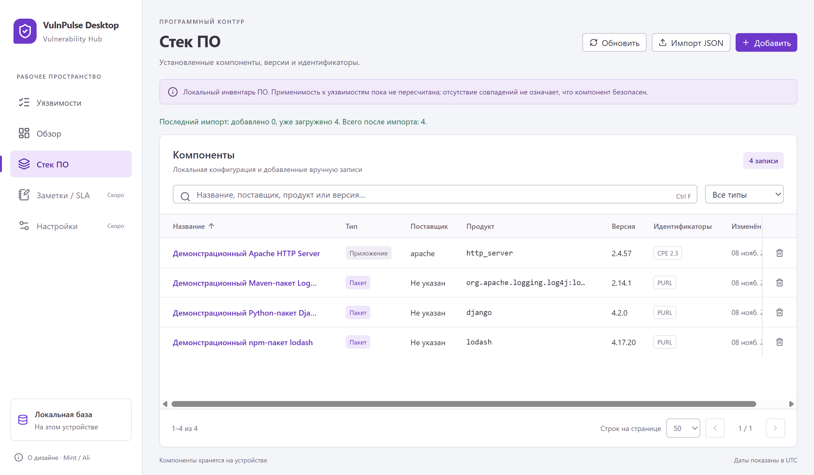

# Стек ПО: таблица, импорт и управление компонентами

Реализовано 2026-11-08 по запросу «продолжи разработку», третий пункт Renderer. Ранее загруженную конфигурацию теперь можно увидеть через пункт **Стек ПО** в sidebar. Повторный импорт для её отображения не нужен. Следующим был интерфейс заметок/SLA; он также [реализован](workflow-ui.md). Текущий следующий пункт — Настройки.

Снимок использует штатный демонстрационный JSON, не пользовательский контур. Другие снимки `stack-{1280,1024}.png` и `stack-editor*.png` содержат синтетические записи для длинных строк, null и безопасного отображения HTML-подобного текста.

## Доступные действия

- Таблица компонентов: название, тип, поставщик, продукт, версия, наличие CPE/PURL и дата изменения UTC. Полные идентификаторы доступны в форме; длинные клетки сокращаются визуально и имеют title. Legacy без версии/идентификаторов читается без подмены неизвестного значения.
- Поиск по name/vendor/product/version с debounce 250 мс, максимум 200 символов; фильтр типа application/system/package. Поиск подстроки/экранирование/сортировки/count выполняет Main. Сортировки name/updatedAt, страницы 25/50/100; новая фильтрация/размер сбрасывают offset, удаление последней строки возвращает к существующей странице. При возврате через sidebar запрос сохраняется.
- Добавление и редактирование с name/kind/vendor/product/version/CPE 2.3/PURL. Конкретная версия и хотя бы один идентификатор обязательны по контракту Main. Пустые optional inputs передаются как null, строки не обрезаются trim молча; поля ограничены 2048 символами. UI не содержит парсеров CPE/PURL или matcher. Противоречия и дубли отклоняются прежним сервисом.
- Удаление требует отдельного подтверждения с текущими названием/product/version. Начальный фокус на отмене; удаляются компонент и его вычисленные совпадения, каталог/заметки/SLA сохраняются.
- Импорт JSON из кнопки раздела и прежнего нативного меню использует один Main picker/import service. Это schemaVersion1/components JSON инвентаря, не OSV advisory. Результат последнего импорта подписан отдельно от текущего общего счёта; повтор не создаёт дубли, ошибочный формат даёт безопасный отказ. Отмена адресована активной операции.

Чтение/запись — через прежний `window.electronAPI.stack`. API, Main, preload, схема, миграции, зависимости и ограничения импорта этим шагом не менялись. Создание/обновление полностью передают поля компонента; id/expectedUpdatedAt берутся из свежего get, ревизия не нормализуется в Renderer.

## Конфликты и неподтверждённые операции

При ошибке сохранения форма остаётся открытой с введённым черновиком. CONFLICT объясняет возможное изменение или дубль; NOT_FOUND, BUSY, ошибка чтения и недоступный ответ различаются. Сообщения провайдеров/SQL не показываются. Перед явным перечитыванием кнопка предупреждает, что форма будет заменена; отдельный generation гарантирует сброс черновика даже при той же ревизии и очень быстром ответе. Без этого UI-тест обнаружил сохранение старого draft после reload; исправление проверено и для той же, и для изменённой ревизии.

Нет оптимистичного успеха или автоматического повтора записи. Ответ UNAVAILABLE может следовать за commit: список перечитывается, пользователю предлагается проверить его перед новой попыткой. Закрытая форма игнорирует поздний get/write; завершившаяся запись всё же инвалидирует список, но не закрывает новую карточку и не меняет её поля. Двойная отправка одного открытого редактора блокируется.

Локальный импорт блокирует записи стека от выбора файла до завершения/отмены; чтение остаётся доступным. Неизвестное состояние импорта показано отдельно. Sequential polling прежнего sync.status — 1 с при активной операции и 3 с в покое — замечает завершение меню/API/cron и перечитывает списки каталога и стека. Нативный selector закрывается пользователем; запрос отмены не применяет выбранный позже файл.

## Применимость и границы

Автоматический запуск matcher, persistence assessments и API перехода к связанным уязвимостям ещё не подключены. Этот экран не выдаёт отсутствие matches за безопасность и не показывает вымышленную кнопку расчёта/связей. Соответствующая часть исходного плана остаётся будущей работой. Текущая реализация — локальный инвентарь и CRUD в пределах существующего API.

Изменение версии/kind/vendor/product/CPE/PURL сбрасывает прежние matches выбранного компонента, rename их сохраняет — это прежнее правило Main. Результаты invalidatedMatches/removedMatches показаны после подтверждённого ответа. Глобальные статусы уязвимостей, заметки/SLA, другие компоненты и их связи сохраняются. Пересчёт не имитируется.

## Компоновка и доступность

Сохранены Mint, системный шрифт, shadcn/Radix primitives и lucide-react. Поиск доступен через Ctrl+F или `/`; горячие клавиши не перехватывают редактируемое поле/диалог. Tab/Shift+Tab остаются в модальном окне, Enter отправляет форму, Escape закрывает с возвратом фокуса к кнопке либо поиску, если строка исчезла. Подсказки отделены от label и связаны aria-describedby.

Плотная таблица прокручивается внутри области, действия удаления закреплены справа. Форма имеет собственную прокрутку и фиксированный нижний ряд действий. Проверены около1280×800,1024×768 и масштаб150%, включая доступность удаления при узком окне и сохранения в форме. Снимки просмотрены. Минимальный размер/другие ОС не закреплялись.

## Фактические проверки

- Финальные typecheck Main/Preload/Renderer и production build успешны. Новые зависимости не устанавливались, отдельный npm audit не запускался.
- Полный Vitest+coverage — **874/874**, 30 файлов; matcher и DashboardService — все100%. Services: statements88,34%, branches87,04%, functions94,95%, lines91,12%. Scope прежний `src/main/services/**`: UI/IPC/preload и compiled XML worker не входят в проценты; UI проверен E2E.
- Полный Electron E2E — **17/17**, 32,2 с после финальных UI-изменений:14 прежних и3 новых `stack-ui.spec.ts`. Production UI/IPC/services/SQLite, отдельные удаляемые профили; Node HTTP/HTTPS новых сценариев запрещён. Native dialogs и контролируемые IPC отказы/задержки подменены.
- Новые сценарии: импорт до входа в раздел/повтор/auto-refresh, CRUD npm PURL и CPE, конкретная версия/несогласованный PURL/дубль, rename против смены версии и ограниченная инвалидация fixture matches, подтверждение/отмена удаления, сохранность каталога/notes/SLA и restart;51 синтетическая запись, поиск literal `%_!`, фильтр типа, сортировки/страницы/сброс offset, legacy null, длинные/HTML-подобные строки, focus/Tab/Enter/Ctrl+F/Escape, DPI/zoom; read/write errors, реальные stale update/delete, explicit reload, late list/get/write, commit с недоставленным подтверждением, BUSY, cancel pending picker и неверный формат файла.

Первые целевые прогоны выявили доступные имена с подсказками/вариантами select и reload, не заменявший черновик при batching; production UI исправлен, финальные прогоны успешны. Предшествующие изменения сохранены, коммит/push не создавались. Рабочая БД/импорт пользователя не открывались и не изменялись. Live feeds, другие ОС, нагрузка100k/p95, backup/restore и установщики этим шагом не проверялись.
