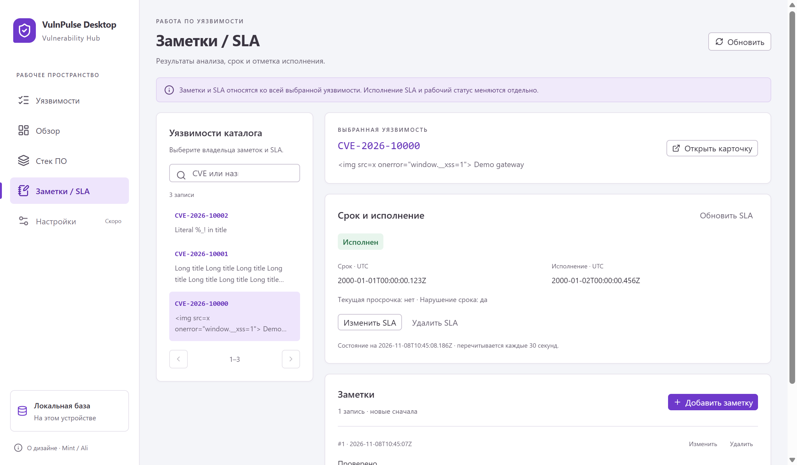

# Заметки / SLA: интерфейс работы по уязвимости

Реализовано 2026-11-08 по запросу «продолжи проект», четвёртый пункт Renderer. Следующий пункт — экран настроек. Main API, preload, схема, миграции и зависимости этим шагом не менялись.

Снимки используют тестовый каталог и локальный OSV demo; это не пользовательский контур. HTML-подобные заголовки и заметки на тестовых данных показываются обычным текстом.

## Владелец и навигация

Откройте **Заметки / SLA** в sidebar и выберите уязвимость. Поиск по CVE/названию использует прежний каталог Main, debounce250мс, до200 символов и страницы по25 записей. Заголовок справа явно сохраняет выбранного владельца, даже если текущий поиск его исключил. Выбор другого владельца сбрасывает страницу заметок и закрывает прежние формы. Общего поиска по текстам заметок всех владельцев этот API не предоставляет.

Из карточки каталога доступна кнопка **Заметки и SLA этой уязвимости**. Обратная кнопка **Открыть карточку** открывает детали точного ID в каталоге; display label сохраняется в UI store и не подменяет ID. App восстанавливает фокус раздела, Dialog — кнопки/заголовка владельца. Ctrl+F или `/` переводит в поиск раздела; ввод и модальные окна не перехватываются.

Workflow принадлежит **всей уязвимости**. Findings и независимые статусы компонентов не добавлены. Переход в каталог и выбранная запись не означают рассчитанную применимость к стеку. Исполнение SLA и `VulnStatus` остаются отдельными ручными действиями.

## Заметки

- Список выбранного владельца, новые по ID сначала,10 записей на странице, общий счёт из Main. После удаления последней заметки страницы выбирается существующая страница. Время создания отображается явно в UTC, прежний SQLite timestamp трактуется как UTC только для показа.
- Создание, чтение свежей версии, редактирование и удаление с подтверждением. Owner и createdAt не редактируются, update/delete передают прочитанный expectedRevision. Удаление начинает с фокуса на отмене. Текст не интерпретируется как HTML/Markdown; переносы сохраняются.
- Новый body ограничен16384 UTF-16 единицами по прежнему API; native textarea имеет тот же maxLength. Ошибки не очищают черновик. Main сохраняет исходные пробелы/переносы и проверяет непустоту/управляющие символы.
- Legacy `bodyTruncated` и текст, который не помещается в лимит редактора (например,16384 emoji с32768 UTF-16 единицами), не подставляются в редактируемый черновик для молчаливой перезаписи. Доступный текст читается отдельно; для замены нужно ввести новый текст целиком и явно отметить соответствующий checkbox. Delete показывает предупреждение об обрезанном предпросмотре.

## SLA и UTC

Назначение/изменение содержит срок и, отдельно, отметку исполнения с датой. Удаление подтверждается отдельно и сохраняет заметки/рабочий статус. Снятие отметки исполнения передаёт patchedAt:null; действие не переводит уязвимость в Patched и не копирует срок CISA KEV.

`datetime-local` используется с явно подписанным **UTC**, а не локальным временем устройства. Сериализация добавляет секунды/миллисекунды и Z, проверяя обратное соответствие без нормализации несуществующего календарного дня. Миллисекунды сохраняются; время не сдвигается из-за часового пояса машины. Main повторно валидирует канонический instant и отклоняет будущее исполнение.

Сохранённые legacy даты показываются дословно. Неоднозначная date-only/повреждённая дата не угадывается в редакторе; требуется полное значение UTC. `dateValuesTruncated` дополнительно требует явного согласия заменить обрезанные даты новыми. Чтение не чинит БД автоматически.

Состояние `open/overdue/completed/unknown`, текущая просрочка, нарушение срока и evaluatedAt приходят из Main. «Исполнен» может сочетаться с нарушенным сроком; unknown не подменяется нулём/ложью. Карточка перечитывается через30с после предыдущего ответа, запросы не накладываются. Изменение часов не записывает ревизию. Открытый редактор не сбрасывается фоновым чтением: его собственный snapshot обновляется только явным перечитыванием.

## Конфликты, ошибки и сохранность

Notes/SLA read/write используют только `window.electronAPI.notes` и `.sla`. SQL, validation и SLA decisions остаются в Main. UI store хранит ownerId, query/offset/revision; запросы и формы имеют отдельные жизненные циклы.

CONFLICT оставляет черновик и предлагает явное **Перечитать и заменить форму**; новый generation сбрасывает форму даже при той же DB revision. SLA передаёт `{id,revision}` либо expected:null при создании, поэтому старый запрос после удаления/recreate не применяется к новой записи. Чтение заметки дополнительно проверяет её owner перед показом формы.

Нет оптимистичного успеха/автоповтора записи. UNAVAILABLE может следовать за commit: список перечитывается, сообщение предлагает проверить сохранённое перед повтором. Late list/get/write не меняют нового владельца/его форму; завершившаяся запись всё же инвалидирует read views. Повторная отправка занятой формы блокируется, provider messages/SQL не отображаются.

Прежний polling sync.status замечает menu/API/cron completion и инвалидирует каталог, стек и workflow. Заметки/SLA разрешены Main во время импорта: фиды не владеют пользовательскими записями. Импорт не сбрасывает workflow. Native OS dialogs и рабочий профиль пользователя этим UI-шагом не управлялись.

## Компоновка и проверки

Mint, Radix/shadcn primitives, системный шрифт и lucide сохранены, новых npm dependencies нет. Слева выбор владельца, справа его карточка/SLA/заметки; при узком окне выбор переходит вверх. Списки и формы прокручиваются внутри, действия формы остаются снизу. Проверены обычное окно,1024×768 и native capture150%: нет внешней горизонтальной прокрутки, кнопка сохранения доступна, focus trap работает. Снимки — `workflow-*.png` в docs/design/screenshots.

- Финальные typecheck Main/Preload/Renderer и production build успешны.
- Vitest+coverage **892/892**,31 файл:18 новых проверок UTC-сериализации, миллисекунд, leap dates, запрета offsets/date-only/неверных календарных значений. Matcher и DashboardService сохраняют100% всех метрик. Services88,34/87,04/94,95/91,12. Coverage scope прежний services: UI/IPC/preload/compiled worker не измеряются этими процентами; новые transport unit-тесты выполняются, UI проверен Electron E2E.
- Полный Electron E2E **21/21**,38,9с:17 прежних+4 workflow UI. Реальные production UI/IPC/SQLite, локальные demo/fixtures, отдельные удаляемые профили; Node HTTP/HTTPS новых сценариев запрещён, native dialogs и контролируемые IPC faults/delays подменены.
- Проверены owner isolation/переходы в обе стороны, note CRUD/HTML-текст/подтверждение удаления, overdue→completed late→reopen и независимый статус, точные UTC milliseconds, import/restart preservation; read errors, конфликт revisions/явный reload/ABA SLA, late list/get/write и commit без подтверждения;26 владельцев/11 заметок/last-page deletion, truncated и oversized emoji body, legacy/dateValuesTruncated correction с явным согласием, keyboard/DPI; отдельные часы Main/Renderer, auto-refresh состояния без записи и отсутствие перекрывающихся read запросов.

Первый targeted тест после restart использовал locator старого Page, а тест часов устанавливал clock после создания таймера. Исправлены тестовые harness/порядок установки часов; production-изменений по этим двум случаям не потребовалось. Финальные прогоны успешны, рабочая БД не открывалась. Новые live feeds/audit/нагрузка/другие ОС/backup/installer не выполнялись. Коммит/push не создавались, прежние изменения сохранены.
